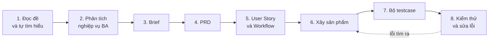

# SocialSync: bài test Quản lý dự án AI cho Doppelherz Việt Nam

Repo này là toàn bộ bài làm của tôi cho đề test vị trí **Quản lý dự án AI**: từ lúc đọc đề, phân tích, viết tài liệu, xây sản phẩm chạy thật, tới lúc kiểm thử.

## Tóm tắt bài test

Đề có 2 câu về cùng một khách hàng là Doppelherz Việt Nam (doppelherz.vn). Tôi làm đủ cả 2 câu, và sản phẩm của Câu 2 đang chạy thật.

| Câu | Đề hỏi | Tôi trả lời |
|---|---|---|
| **Câu 1** | Tìm hiểu công ty. Với 6 phòng ban đề giả định: việc nào ứng dụng được AI hoặc tự động hóa, công cụ gì, ưu tiên ra sao, lợi bao nhiêu, khó bao nhiêu. Chọn 3 hạng mục làm trước. | **45 việc** ở 9 nhóm (Kinh doanh tách 4 kênh), chấm điểm theo 5 tiêu chí, chọn **3 hạng mục làm trước** |
| **Câu 2** | Đóng vai **đối tác tư vấn và triển khai**: khảo sát, đưa giải pháp, báo giá trong 40–50 triệu đồng, và làm hệ thống **tự đồng bộ nội dung từ Website lên Facebook và Pinterest**. | Đủ 7 mục của đề, báo giá **49,9 triệu đồng**, sản phẩm **chạy thật**: bài lên Facebook 7 giây, lên Pinterest 11 giây sau khi duyệt |

**Mở chung cho cả bài:**
- **Đề bài gốc:** [Bai_test_Quan_ly_du_an_AI.docx.md](Bai_test_Quan_ly_du_an_AI.docx.md)
- **Toàn bộ bài nộp theo thứ tự của đề:** [nop-bai/00-muc-luc.md](nop-bai/00-muc-luc.md)

Bạn không cần biết code. Mỗi phần dưới đây đều có **việc đã làm, kết quả, và link để mở xem**.

---

## Câu 1. Khảo sát doanh nghiệp và đề xuất tự động hóa

**Đọc ở đây:** [Trang Câu 1](https://claude.ai/artifact/FsKK78CG1AkM2sXtHRuBhn), có sơ đồ và bảng trực quan. Bản gốc dạng văn bản: [nop-bai/01-cau-1-khao-sat-tu-dong-hoa.md](nop-bai/01-cau-1-khao-sat-tu-dong-hoa.md).

**Cách làm:**
- **Hiểu công ty:** chỉ dùng đề bài và nguồn công khai. Số tự đo trên doppelherz.vn ngày 19/11/2026, ví dụ 46 file PDF thông báo chương trình bán hàng đăng công khai trong 1 ngày.
- **Lập bản đồ:** 45 việc có thể tự động hóa ở HCNS, Kế toán, Kinh doanh (OTC, ETC, MT, Online), Kho, Dịch vụ bán hàng, Marketing. Mỗi việc có công cụ gợi ý, lợi ích ước tính, độ khó, mức ưu tiên.
- **Chấm điểm:** 12 hạng mục ứng viên chấm theo 5 tiêu chí: lợi ích (nhân đôi), dễ triển khai, dữ liệu sẵn có, rủi ro thấp, tạo niềm tin. Tối đa 30 điểm.
- **Đặt lên ma trận:** lợi ích × độ khó, chọn ở góc "lợi ích cao, dễ làm".

**Ba hạng mục nên làm trước:**

| Thứ tự | Hạng mục | Cho ai | Điểm |
|---|---|---|---|
| 1 | Dây chuyền nội dung đa kênh có cổng tuân thủ. Đây là dự án ở Câu 2. | Marketing | 25/30 |
| 2 | Sổ chương trình bán hàng số và trợ lý tra cứu | Kinh doanh 4 kênh, Dịch vụ bán hàng | 25/30 |
| 3 | Báo cáo bán hàng hợp nhất tự động | Ban giám đốc, Kinh doanh, Kế toán | 24/30 |

**Vì sao là 3 việc này:**
- **Dùng chung một nền:** làm cái sau rẻ hơn cái trước.
- **Mỗi việc phục vụ một nhóm người khác nhau:** sau 3 dự án, cả Marketing, lực lượng bán hàng và ban giám đốc đều thấy kết quả.
- **Mở đường cho việc lớn hơn:** hạng mục 2 là nền cho nhận đơn tự động và tính chiết khấu tự động. Đó là hai việc lợi ích lớn nhất nhưng khó nhất.

**Giới hạn:** tôi không có số liệu nội bộ. Mọi con số giờ công là giả định để minh họa cách tính, có gắn nhãn, và sẽ chấm lại cùng trưởng các phòng sau buổi khảo sát.

---

## Câu 2. Dự án mẫu SocialSync: đồng bộ nội dung Website, Facebook, Pinterest

### Đọc nhanh trong 2 phút

| Bạn muốn xem | Mở ở đây |
|---|---|
| Sản phẩm đang chạy | https://shop.adaptivealgo.uk (tài khoản dùng thử gửi kèm bài nộp) |
| Hướng dẫn dùng có ảnh, từng bước | [nop-bai/08-huong-dan-tung-buoc.md](nop-bai/08-huong-dan-tung-buoc.md) |
| Phân tích nghiệp vụ (BA) | [Trang BA](https://claude.ai/artifact/S3HXHY2s9fRihC4KYJfZu2) |
| 27 User Story và sơ đồ toàn cảnh | [Trang User Story và Workflow](https://claude.ai/artifact/4Frq7Z589JAp3sdWNMTUWn) |
| Bộ testcase và kết quả kiểm thử | [kiem-thu/testcase-trung-tam-socialsync.md](kiem-thu/testcase-trung-tam-socialsync.md) |

**Kết quả chính:**
- **Sản phẩm:** 27/27 User Story chạy trên bản demo.
- **Chạy thật ngày 20/11/2026:** đăng một bài trên website, sau khi duyệt bài lên Facebook trong **7 giây** và lên Pinterest trong **11 giây**.
- **Kiểm thử:** 192 testcase. 75 đã chạy và đạt. 16 lỗi tìm ra, đã sửa, đã kiểm lại.
- **Báo giá:** 49,9 triệu đồng (phương án đề xuất) hoặc 42,4 triệu đồng (tối thiểu) cho năm đầu, đã gồm vận hành 12 tháng.

### Hành trình làm Câu 2: 8 bước



#### Bước 1. Đọc đề và tự tìm hiểu

**Mục đích:** hiểu đề đang kiểm tra năng lực gì, và hiểu khách hàng qua những gì công khai. Không đoán thông tin nội bộ.

**Việc đã làm:**
- **Phân tích đề:** tách từng phần của đề, xác định mỗi phần kiểm tra năng lực gì. Ví dụ: ngân sách 40–50 triệu loại bỏ phương án viết phần mềm riêng từ đầu, buộc dùng công cụ low-code và phải tính phí vận hành.
- **Đo website doppelherz.vn:** tải dữ liệu công khai của toàn bộ 2.125 bài viết, danh mục, cấu trúc 40 bài mẫu, danh sách sản phẩm có số xác nhận quảng cáo.
- **Xem kênh mẫu:** Pinterest của Doppelherz Đức (19 Pin, 10 board) để học cách trình bày.
- **Tìm hiểu quy định:** quảng cáo thực phẩm bảo vệ sức khỏe (nguồn thứ cấp, có ghi rõ là không thay ý kiến pháp lý).

**Kết quả:** 7 điểm đau, mỗi điểm kèm hệ quả cho thiết kế. Ví dụ:
- **Đăng theo đợt:** chỉ 66/342 ngày có bài mới. Hệ thống cần lịch đăng rải đều.
- **Trộn nội dung:** 46 thông báo đại lý dạng PDF trong 1 ngày. Không thể đồng bộ "mù", phải có bộ lọc và người duyệt.
- **Không đo được kênh:** 0/40 bài mẫu có mã theo dõi UTM.

**Xem ở đâu:**
- [research/01_phan_tich_de_bai.md](research/01_phan_tich_de_bai.md): đề kiểm tra gì, số đo website, 7 điểm đau
- [research/02_template_3_kenh_va_huong_prototype.md](research/02_template_3_kenh_va_huong_prototype.md): hiện trạng 3 kênh, lưu ý quảng cáo ngành
- [research/HANDOFF.md](research/HANDOFF.md): tóm tắt nghiên cứu, thứ tự đọc
- Dữ liệu thô: [research/doppelherz_posts_all.csv](research/doppelherz_posts_all.csv) (2.125 bài), [research/doppelherz_san_pham_xnqc.csv](research/doppelherz_san_pham_xnqc.csv) (sản phẩm và số XNQC), [research/MANIFEST.csv](research/MANIFEST.csv) (mã kiểm tra từng file)

#### Bước 2. Phân tích nghiệp vụ (BA)

**Mục đích:** chuyển những gì tìm hiểu được thành bài toán của khách hàng: vấn đề, mục tiêu, chỉ số, phạm vi, ai làm gì.

**Việc đã làm:**
- **Câu 1 của đề:** bản đồ việc có thể tự động hóa ở 6 phòng ban mà đề giả định (Kinh doanh tách 4 kênh OTC, ETC, MT, Online). Chấm ưu tiên theo 5 tiêu chí, chọn 3 hạng mục làm trước.
- **Chẩn đoán hiện trạng ("khám bệnh"):** những gì đo được từ bên ngoài, và bộ câu hỏi khảo sát cho những gì chưa biết.
- **Tài liệu BA:** tóm tắt cho khách, vấn đề, các phương án, người dùng, chỉ số thành công, quy tắc tuân thủ, lộ trình có cổng duyệt, chi phí, rủi ro, câu hỏi khảo sát.

**Kết quả:** một chỉ số chính ("tỉ lệ bài đủ điều kiện có mặt trên kênh trong 24 giờ"), cùng 3 chỉ số chặn rủi ro: bài vi phạm lên kênh = 0, bài chưa duyệt lên kênh = 0, bài đăng trùng = 0.

**Xem ở đâu:**
- [Trang BA](https://claude.ai/artifact/S3HXHY2s9fRihC4KYJfZu2): bản trình bày đầy đủ, theo khung BABOK v3
- [Trang Câu 1](https://claude.ai/artifact/FsKK78CG1AkM2sXtHRuBhn) và [nop-bai/01-cau-1-khao-sat-tu-dong-hoa.md](nop-bai/01-cau-1-khao-sat-tu-dong-hoa.md): Câu 1
- [nop-bai/02-1-chan-doan-hien-trang.md](nop-bai/02-1-chan-doan-hien-trang.md): Câu 2.1, chẩn đoán và câu hỏi khảo sát

#### Bước 3. Viết Brief

**Mục đích:** chốt một trang về "làm gì, vì sao, đến đâu" trước khi viết yêu cầu chi tiết.

**Nội dung:** bối cảnh, vấn đề, so sánh với các cách làm có sẵn, mục tiêu và tiêu chí thành công, phạm vi theo mức ưu tiên (bắt buộc, nên có, có thì tốt), ràng buộc, giả định, rủi ro, kế hoạch 24 giờ.

**Một quyết định quan trọng ở bước này:** demo không thể đăng bài lên doppelherz.vn thật. Vì vậy demo dùng một website WooCommerce riêng đóng vai website khách, và kênh mạng xã hội của ứng viên đóng vai kênh khách.

**Xem ở đâu:** [SocialSync-Brief.md](SocialSync-Brief.md)

#### Bước 4. Viết PRD

**Mục đích:** đặc tả đủ chi tiết để xây được và nghiệm thu được.

**Nội dung:**
- 15 User Story ban đầu
- Nội dung đăng theo từng kênh, trạng thái của một lượt đồng bộ, luồng hoạt động
- Mô hình dữ liệu, cách ghi log, yêu cầu phi chức năng, xử lý lỗi
- Tiêu chí nghiệm thu
- Phần riêng cho AI: AI làm đơn vị việc gì, đánh giá đầu ra thế nào, khi model hỏng thì xử lý ra sao

**Xem ở đâu:** [SocialSync-PRD.md](SocialSync-PRD.md)

#### Bước 5. Viết User Story và Workflow

**Mục đích:** nhìn toàn bộ sản phẩm trên một trang: ai cần gì, và một bài đi qua những bước nào.

**Kết quả:**
- **27 User Story** chia 5 nhóm: đăng một lần lên đủ kênh; AI phân loại và viết; con người duyệt; theo dõi và báo cáo; bảo mật và vận hành. Bộ này mở rộng từ 15 story của PRD sau khi chốt phạm vi.
- **Sơ đồ làn bơi:** 6 cột (đội nội dung, website, n8n, Claude, kênh, quản lý) và 6 bước, kèm mọi nhánh rẽ (bị chặn, AI lỗi, từ chối, hủy lịch, kênh báo lỗi).
- **Sơ đồ quy trình** và **bộ prompt AI** đang chạy, nộp theo mục 2.4 và 2.5 của đề.

**Xem ở đâu:**
- [Trang User Story và Workflow](https://claude.ai/artifact/4Frq7Z589JAp3sdWNMTUWn)
- [nop-bai/04-so-do-quy-trinh.md](nop-bai/04-so-do-quy-trinh.md): kiến trúc, luồng một bài, vòng đời một lượt, màn hình
- [nop-bai/05-bo-prompt.md](nop-bai/05-bo-prompt.md): prompt nguyên văn và kết quả thử

#### Bước 6. Xây sản phẩm

**Mục đích:** làm ra hệ thống chạy thật (mục 2.6 của đề), không chỉ trình bày trên giấy.

**Hệ thống gồm 4 phần:**

| Phần | Vai trò | Mã nguồn |
|---|---|---|
| Plugin WordPress "SocialSync" | Bắt sự kiện đăng bài, xếp lịch, màn hình duyệt (Trung tâm SocialSync), nhật ký, báo cáo | [plugin/social-sync/](plugin/social-sync/) |
| n8n (tự host) | Gọi AI, kiểm nội dung, chờ tới giờ, đăng bài, báo lỗi, báo cáo tuần | [n8n/workflows/](n8n/workflows/) |
| Claude (AI) | Phân loại bài, viết nội dung riêng cho Facebook và Pinterest trong 1 lần gọi | Prompt trong [nop-bai/05-bo-prompt.md](nop-bai/05-bo-prompt.md) |
| Facebook Graph API, Make.com → Pinterest | Đăng bài lên kênh | Cấu hình trong n8n |

**Cách xây:** làm theo thứ tự ưu tiên của Brief.
- **Mức bắt buộc trước:** đăng bài là lên kênh.
- **Rồi tới mức nên có:**
  - AI viết lại nội dung;
  - lịch đăng;
  - duyệt trước khi đăng;
  - kiểm từ cấm;
  - báo cáo tuần.
- **Rà lại trải nghiệm:** sau một vòng rà soát giao diện, các màn hình rời rạc được gộp thành **Trung tâm SocialSync**. Người duyệt xem, sửa, duyệt, đổi giờ, hủy lịch và theo dõi trên một màn hình.

**Thiết kế chống rủi ro:**
- **Duyệt bắt buộc:** chế độ mặc định, nên AI không tự đăng.
- **Lọc trước khi gửi:** bài thuộc danh mục nội bộ hoặc thông báo đại lý bị chặn ngay ở website.
- **Hỏi lại trước khi đăng:** tới giờ đăng, n8n hỏi lại website "còn đăng không?", nên bài đã hủy hoặc đổi giờ không bị đăng nhầm.
- **AI lỗi vẫn chạy tiếp:** khi AI lỗi, hệ thống dùng nội dung mẫu và ghi lý do.

**Xem sản phẩm:**

| Thành phần | Địa chỉ |
|---|---|
| Website demo | https://shop.adaptivealgo.uk |
| Trang quản trị (đăng nhập bằng tài khoản dùng thử) | https://shop.adaptivealgo.uk/wp-admin |
| Hướng dẫn dùng thử 5 phút | [nop-bai/06-san-pham-chay-that.md](nop-bai/06-san-pham-chay-that.md) |
| Hướng dẫn có 16 ảnh chụp từng bước | [nop-bai/08-huong-dan-tung-buoc.md](nop-bai/08-huong-dan-tung-buoc.md) |

#### Bước 7. Xây bộ testcase

**Mục đích:** kiểm sản phẩm bằng con mắt khác với người xây.

**Cách làm:**
- **Người viết testcase:** một vai Tester độc lập (một phiên AI riêng) viết testcase. Người này đọc code để tìm rủi ro trước khi chạy.
- **Điều kiện chạy:** Tester chỉ được chạy các ca làm đổi dữ liệu thật sau khi PM cho phép.

**Kết quả:** **192 testcase trong 19 nhóm**, mỗi ca có mức ưu tiên, các bước, kết quả mong đợi. Các nhóm gồm:
- điều hướng, quyền truy cập;
- duyệt, sửa nội dung, đổi giờ và hủy lịch sau duyệt;
- chống đăng trùng, lỗi kênh, AI, bảo mật, báo cáo, cấu hình;
- luồng đầu-cuối.

**Xem ở đâu:** [kiem-thu/testcase-trung-tam-socialsync.md](kiem-thu/testcase-trung-tam-socialsync.md), mục 3

#### Bước 8. Kiểm thử và sửa lỗi

**Mục đích:** chứng minh sản phẩm chạy đúng, và ghi rõ phần chưa kiểm.

**Kết quả kiểm thử ngày 20/11/2026:**

| Chỉ số | Số |
|---|---|
| Testcase đã chạy và đạt | 75 (4 đạt một phần) |
| Lỗi tìm ra, đã sửa, đã kiểm lại đạt | 16 (1 lỗi mức P1) |
| Lần đăng công khai trong cả đợt kiểm thử | 1 (luồng thật đầu-cuối bên dưới) |

**Những điểm quan trọng nhất đã kiểm:**
- **Hủy lịch hoặc đổi giờ:** lệnh đăng cũ không đăng.
- **Không đăng trùng:** không trùng khi sửa bài, gửi lại form, hay bấm đồng bộ 2 lần.
- **Bài bị chặn:** bài bị chặn ở website không có đường nào lên kênh.

**Luồng thật đầu-cuối:** bài thật của doppelherz.vn được dùng làm bài thử.

| Mốc | Giờ | Link kiểm chứng |
|---|---|---|
| Đăng trên website | 10:36:46 | [Bài trên website demo](https://shop.adaptivealgo.uk/sac-dep-phu-nu-ve-dep-ben-vung-bat-dau-tu-suc-khoe-ben-trong/) |
| Claude phân loại và viết xong | ~10:37:07 | Xem trong Trung tâm SocialSync, bài #104 |
| Người duyệt bấm duyệt (duyệt nguyên văn) | 10:37:16 | Dòng thời gian của bài #104 |
| Bài lên Facebook | 10:37:23 | [Bài trên Fanpage](https://www.facebook.com/273106486233478_1673540541136856) |
| Pin lên Pinterest, board "Làm đẹp" | 10:37:27 | [Pin trên Pinterest](https://www.pinterest.com/pin/255016397645931981/) |

**Phần chưa kiểm, ghi rõ trong bài nộp:**
- **117 testcase chưa chạy.**
- **Chưa thử 2 vai trò:** Biên tập viên và Tác giả.
- **4 ca chưa chạy đầu-cuối trên kênh thật:** các ca này cần đăng thật hoặc làm hỏng kênh, nên mới kiểm ở tầng dữ liệu.

**Xem ở đâu:**
- [kiem-thu/testcase-trung-tam-socialsync.md](kiem-thu/testcase-trung-tam-socialsync.md), phần "Tổng kết" ở đầu file và mục 6 "Kết quả chạy"
- [nop-bai/06-san-pham-chay-that.md](nop-bai/06-san-pham-chay-that.md), mục 4 (đã kiểm chứng) và mục 5 (giới hạn)

---

## Đối chiếu với từng yêu cầu của đề

| Yêu cầu của đề | Tài liệu |
|---|---|
| Câu 1: tự động hóa theo phòng ban, ưu tiên, lợi ích, 3 hạng mục làm trước | [Trang Câu 1](https://claude.ai/artifact/FsKK78CG1AkM2sXtHRuBhn), [01-cau-1-khao-sat-tu-dong-hoa.md](nop-bai/01-cau-1-khao-sat-tu-dong-hoa.md) |
| 2.1 Chẩn đoán hiện trạng và câu hỏi khảo sát | [02-1-chan-doan-hien-trang.md](nop-bai/02-1-chan-doan-hien-trang.md) |
| 2.2 Kế hoạch: giai đoạn, mốc, nhân sự, công cụ | [02-2-ke-hoach-trien-khai.md](nop-bai/02-2-ke-hoach-trien-khai.md) |
| 2.3 Báo giá trong 40–50 triệu, gồm vận hành | [02-3-bao-gia.md](nop-bai/02-3-bao-gia.md) |
| 2.4 Sơ đồ quy trình, wireframe | [04-so-do-quy-trinh.md](nop-bai/04-so-do-quy-trinh.md) |
| 2.5 Bộ prompt | [05-bo-prompt.md](nop-bai/05-bo-prompt.md) |
| 2.6 Sản phẩm chạy thật | [06-san-pham-chay-that.md](nop-bai/06-san-pham-chay-that.md), [08-huong-dan-tung-buoc.md](nop-bai/08-huong-dan-tung-buoc.md), mã nguồn [plugin/](plugin/) và [n8n/](n8n/) |
| 2.7 Lộ trình mở rộng | [07-lo-trinh-mo-rong.md](nop-bai/07-lo-trinh-mo-rong.md) |

---

## Cách tôi làm việc

**Vai trò của tôi:** Product Owner và Quản lý dự án. Tôi điều phối các AI agent (Claude Code) ở các vai:
- phân tích và lập trình;
- rà soát giao diện;
- kiểm thử độc lập.

Tôi tự làm các việc cần tài khoản thật:
- cài máy chủ;
- tạo app Facebook;
- dựng kịch bản Make cho Pinterest;
- duyệt mọi quyết định.

**Bốn quy tắc áp dụng cho cả người và AI trong dự án:**
1. **Phân tích trước, làm sau:** phân tích, thảo luận, chờ đồng ý rõ ràng rồi mới viết code.
2. **Log mọi bước:** mỗi bước của hệ thống ghi log, có một mã yêu cầu chung giữa website và n8n, để truy được lỗi.
3. **Không sửa mò:** dùng log tìm nguyên nhân gốc trước khi sửa.
4. **Không bịa thông tin:** thông tin về công ty chỉ lấy từ đề bài và website công khai. Mọi điều chưa kiểm chứng đều gắn nhãn.

| Nhãn trong tài liệu | Nghĩa |
|---|---|
| [Đo] | Số đo trực tiếp |
| [Suy luận] | Ước tính có lập luận, chưa có số đo |
| [Giả định] | Con số chọn để tính, cần khách xác nhận |
| [Chưa xác minh] | Chưa kiểm được trên nguồn chính thức |

---

## Cấu trúc repo

```
├── Bai_test_Quan_ly_du_an_AI.docx.md   Đề bài gốc
├── research/                           Bước 1: tìm hiểu đề và website, dữ liệu đo được
├── SocialSync-Brief.md                 Bước 3: Brief
├── SocialSync-PRD.md                   Bước 4: PRD
├── nop-bai/                            Bài nộp theo đúng thứ tự của đề (mở 00-muc-luc.md trước)
│   └── anh-huong-dan/                  16 ảnh chụp cho hướng dẫn từng bước
├── plugin/social-sync/                 Bước 6: plugin WordPress
├── n8n/workflows/                      Bước 6: 3 luồng n8n (chính, báo lỗi, báo cáo tuần)
├── kiem-thu/                           Bước 7–8: bộ testcase và kết quả
├── scripts/                            Script hỗ trợ triển khai n8n và thử Make
├── docker/, docker-compose.yml         Cấu hình chạy website demo và n8n
└── .env.example                        Mẫu biến môi trường (khóa thật không có trong repo)
```

---

## Giới hạn cần biết

- **Website demo không phải doppelherz.vn.** Ứng viên không có quyền đăng bài lên website thật. Fanpage "Mint Shop" và tài khoản Pinterest là kênh thử của ứng viên.
- **Bài và ảnh mẫu lấy từ doppelherz.vn** để minh họa, có ghi nguồn trong bài.
- **Máy chủ demo đặt tại nhà ứng viên.** Bản chính thức đề xuất máy chủ trong nước, đứng tên khách.
- **Phần chưa làm hoặc chưa kiểm** được liệt kê ở [nop-bai/06-san-pham-chay-that.md](nop-bai/06-san-pham-chay-that.md) mục 5 và [kiem-thu/testcase-trung-tam-socialsync.md](kiem-thu/testcase-trung-tam-socialsync.md).
- **Bảo mật:** khóa API, token và mật khẩu không có trong repo. Repo được quét bí mật trước mỗi lần đẩy mã.
