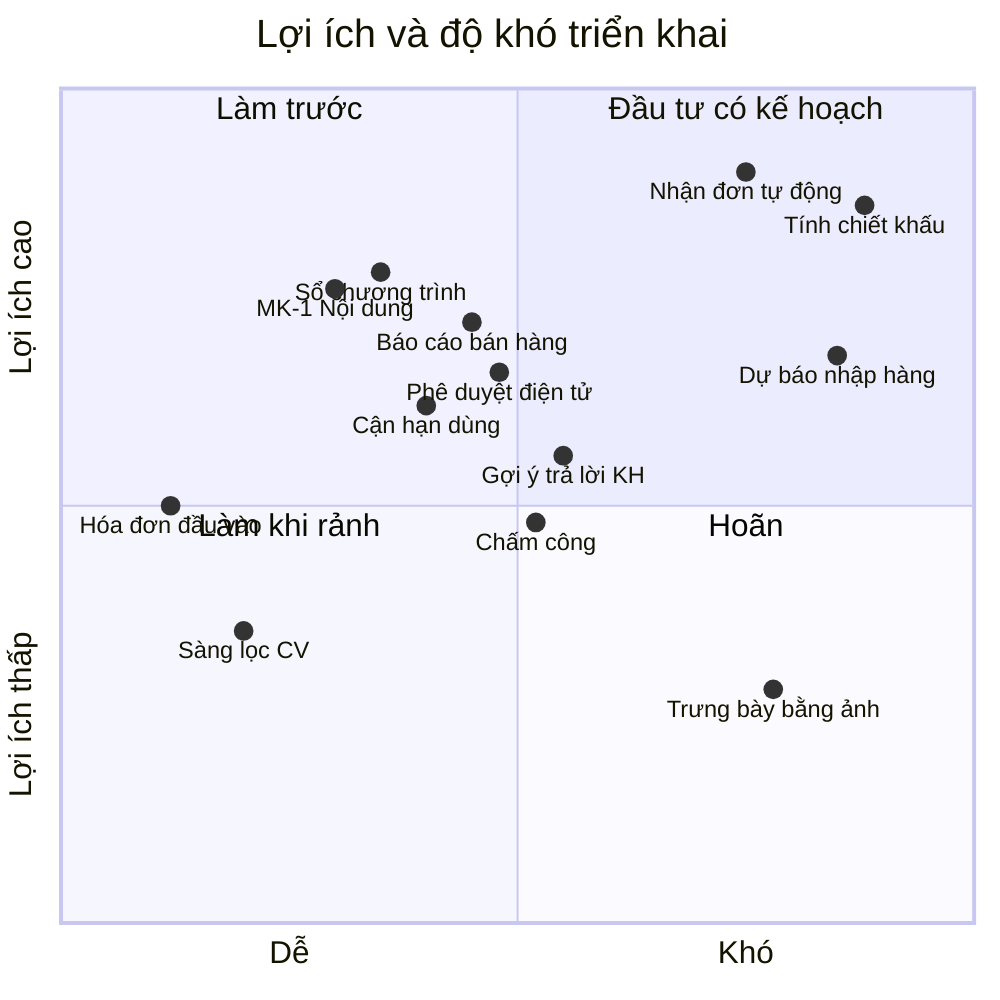

# Câu 1 – Khảo sát Doppelherz Việt Nam và đề xuất tự động hóa

Ngày lập: 19/11/2026. Người lập: ứng viên vị trí Quản lý dự án AI.

**Cách đọc nhãn.** Không gắn nhãn: dữ kiện có nguồn ở cuối tài liệu, hoặc số tôi tự đo trên website doppelherz.vn ngày 19/11/2026 (ghi **[Đo]**). **[Suy luận]**: ước tính hoặc nhận định có lý do nhưng chưa được doanh nghiệp xác nhận. **[Chưa xác minh]**: thông tin từ nguồn thứ cấp hoặc chưa kiểm tra được. Tôi không có số liệu nội bộ của công ty. Mọi con số về thời gian, khối lượng việc là giả định để minh họa cách tính, cần thay bằng số thật khi khảo sát.

## Tóm tắt

Ba hạng mục nên làm trước:

1. **Marketing – Dây chuyền nội dung đa kênh có cổng tuân thủ.** Đây chính là dự án số 1 ở Câu 2. Dữ liệu công khai, làm được ngay, có người duyệt nên rủi ro quảng cáo được kiểm soát.
2. **Kinh doanh (cả 4 kênh) + Dịch vụ bán hàng – Sổ chương trình bán hàng số và trợ lý tra cứu.** Riêng năm 2026 công ty đã đánh số tới thông báo chương trình 2026-046.TB, chia theo kênh, vùng, hạng đại lý và sản phẩm **[Đo]**. Nhân viên kinh doanh, đại lý và kế toán cùng phải tra đúng chương trình mỗi ngày.
3. **Kinh doanh + Kế toán + Ban giám đốc – Báo cáo bán hàng hợp nhất tự động.** Rủi ro pháp lý thấp. Ban giám đốc thấy giá trị ngay. Đây cũng là nền dữ liệu cho chấm KPI, dự báo nhập hàng và đo hiệu quả truyền thông về sau.

So với giả thuyết ban đầu trong nghiên cứu, tôi giữ (1) và (2), thay "gợi ý trả lời tin nhắn khách hàng" bằng (3). Lý do ở mục 5.4.

---

## 1. Hiểu biết về doanh nghiệp

| Dữ kiện | Nguồn |
|---|---|
| Pháp nhân: CTCP Mastertran. Là nhà phân phối độc quyền Doppelherz của Queisser Pharma (Đức) tại Việt Nam. Hợp tác từ 2012; hai sản phẩm đầu tiên ra thị trường tháng 6/2013 | Trang "Về chúng tôi" doppelherz.vn; `research/01` mục 2 |
| Năm thành lập ghi chưa thống nhất: trang công ty ghi 2010; VietnamWorks và hồ sơ triển lãm ghi 2011. Thông báo "2026-040.TB – Chương trình kỷ niệm 15 năm công ty" khớp với mốc 2011 **[Suy luận]** | doppelherz.vn; vietnamworks.com; german-pavilion.com; `research/doppelherz_posts_12thang.csv` |
| Văn phòng giao dịch tại Hà Nội (Capital Place, Ba Đình), chi nhánh TP.HCM (Quận 7) | Trang "Về chúng tôi" |
| Mastertran là đơn vị nhập khẩu và chịu trách nhiệm sản phẩm trên nhãn hàng bán tại chuỗi nhà thuốc | pharmacity.vn (trang sản phẩm Doppelherz) |
| Kênh bán: OTC (nhà thuốc), ETC (bệnh viện/phòng khám), MT (siêu thị, chuỗi hiện đại), Online (website WooCommerce, Shopee, Lazada). Mục tiêu công bố ~12.000 đại lý OTC và 5.000 điểm MT | `research/01` mục 2; trungtamthuoc.com (nguồn quảng bá, ghi "63 tỉnh thành") |
| 36 trang sản phẩm. 34/36 ghi số xác nhận nội dung quảng cáo (XNQC) và công dụng được phép nói | **[Đo]** `research/02` mục 1.1 |
| Website có 2.125 bài (6/2020–10/2026), 1.300 bài "Kiến thức sức khỏe". 12 tháng gần nhất có 219 bài, đăng theo đợt. 84,5% bài do một tài khoản đăng | **[Đo]** `research/01` mục 3 |
| Ngày 25/08/2026, 46 file PDF thông báo chương trình bán hàng được đăng công khai lên website. Tiêu đề cho thấy chương trình được chia theo kênh (OTC, ETC, OL), vùng (MB, MT1, MT2, MN), hạng đại lý (nhỏ, vừa, chỉ định, mở mới), sản phẩm (Kinder, Collagenmax, Beauty Collagen) và mùa vụ (Tết, 30/4, tháng 7). Ở đây "MT1/MT2" nhiều khả năng là Miền Trung 1/2, không phải kênh siêu thị **[Suy luận]** | **[Đo]** `research/doppelherz_posts_12thang.csv` |
| Fanpage Facebook ~628 nghìn người theo dõi; có Zalo OA, YouTube, Instagram; hotline 1800 1770 | `research/01`, `research/02` |
| Sản phẩm là thực phẩm bảo vệ sức khỏe (TPBVSK). Quảng cáo phải được xác nhận trước, phải có cụm "Thực phẩm bảo vệ sức khỏe" và câu khuyến cáo "không phải là thuốc", cấm dùng hình ảnh bác sĩ/cơ sở y tế. Văn bản pháp lý thay đổi nhiều trong 2026 | `research/02` mục 4 |

**Điều tôi chưa biết.** Tôi chưa biết số nhân sự từng phòng, phần mềm đang dùng (ERP, DMS, kế toán, HRM), khối lượng đơn hàng mỗi ngày và quy trình duyệt nội bộ. Đây là nội dung phải hỏi ở buổi khảo sát (mục 6). Vì vậy các mức ưu tiên dưới đây là bản đề xuất ban đầu, sẽ chấm lại cùng trưởng các phòng.

**Mô hình hoạt động rút gọn [Suy luận].** Công ty nhập hàng từ Đức, lưu kho rồi bán cho hàng nghìn điểm bán qua đội kinh doanh theo vùng. Doanh thu chịu ảnh hưởng mạnh của chương trình bán hàng cho đại lý. Chuỗi việc lõi gồm: đặt hàng → áp chương trình → xuất kho, giao hàng → hóa đơn → công nợ → tính thưởng/chiết khấu. Lỗi ở khâu "áp chương trình" sẽ lan sang kho, kế toán và quan hệ với đại lý. Marketing tạo nhu cầu cho người tiêu dùng nhưng bị ràng buộc pháp lý chặt.

## 2. Cách chấm ưu tiên

Mỗi hạng mục được chấm 5 tiêu chí, thang 1–5:

| Tiêu chí | Câu hỏi | Trọng số |
|---|---|---|
| Lợi ích (L) | Tiết kiệm bao nhiêu giờ, giảm lỗi tốn kém nào, có tác động tới doanh thu không? | ×2 |
| Dễ triển khai (D) | Có công cụ sẵn không, có phải tích hợp hệ thống lõi không, phải đổi thói quen của bao nhiêu người? | ×1 |
| Dữ liệu sẵn có (S) | Dữ liệu đầu vào đã tồn tại và đọc được chưa? | ×1 |
| Rủi ro thấp (R) | Nếu sai thì hậu quả là gì: pháp lý, tiền, uy tín, quyền lợi người lao động? | ×1 |
| Tạo niềm tin (N) | Người dùng và ban giám đốc có thấy kết quả nhanh không, có làm nền cho dự án sau không? | ×1 |

Điểm tối đa là 30. **Cao** khi đạt ≥ 22 điểm: nên làm trong 12 tháng tới. **Trung bình** khi đạt 16–21: làm khi đủ điều kiện, thường là năm thứ hai. **Thấp** khi ≤ 15: theo dõi, chưa đầu tư.

Thang độ khó dùng trong các bảng: **Dễ** – dưới 4 tuần, dùng công cụ có sẵn, không tích hợp hệ thống lõi. **TB** – 1–3 tháng, có tích hợp hoặc đổi quy trình của một phòng. **Khó** – trên 3 tháng, cần tích hợp ERP/DMS hoặc đổi quy trình nhiều phòng hay cả lực lượng bán hàng.

## 3. Bản đồ cơ hội theo phòng ban

Cột "Lợi ích ước tính" toàn bộ là **[Suy luận]**. Mỗi con số đi kèm giả định để doanh nghiệp thay bằng số thật. "Chuyên dụng" nghĩa là phần mềm ngành hoặc nghiệp vụ riêng, cần mua bản quyền. Tên công cụ là gợi ý để so sánh, không phải cam kết chọn nhà cung cấp.

Hạ tầng dùng chung cho hầu hết hạng mục: **n8n** (tự host, bản Community miễn phí) hoặc **Make** để nối hệ thống; **Claude API** hoặc **ChatGPT/Claude bản doanh nghiệp** cho phần AI; **Google Sheets/Looker Studio** hoặc **Microsoft 365/Power BI** tùy công ty đang dùng bộ nào. Ưu tiên dùng lại thứ công ty đã trả tiền.

### 3.1 Hành chính nhân sự (HCNS)

| Mã | Công việc | Công cụ gợi ý | Lợi ích ước tính | Độ khó | Ưu tiên |
|---|---|---|---|---|---|
| NS-1 | Chuẩn hóa hồ sơ nhân sự, sơ đồ tổ chức, chức danh, ma trận "ai duyệt việc gì" | HRM chuyên dụng (MISA AMIS Nhân sự, Base HRM, 1Office) hoặc Google Sheets có cấu trúc ở giai đoạn đầu | Một nguồn dữ liệu duy nhất. Là điều kiện bắt buộc cho phê duyệt điện tử, chấm công, KPI | Dễ–TB | Cao (nền móng) |
| NS-2 | Đề xuất – phê duyệt điện tử: nghỉ phép, tạm ứng, công tác, mua sắm | Văn phòng số chuyên dụng (MISA AMIS Văn phòng số, Base Request, 1Office) hoặc Google Workspace + AppSheet / Microsoft 365 + Power Automate | Giả định mỗi đề xuất giấy chờ 1–3 ngày khi người duyệt đi thị trường; điện tử rút còn trong ngày, có lịch sử tra cứu | TB (khó ở thói quen, không ở kỹ thuật) | Cao |
| NS-3 | Chấm công, tính lương; chấm công GPS cho nhân viên thị trường | Máy chấm công + phần mềm chuyên dụng (AMIS Chấm công/Tiền lương, Base Checkin, 1Office) | Giả định HCNS mất 2–4 ngày/tháng gom công từ nhiều nguồn; còn 0,5–1 ngày; ít khiếu nại sai công | TB | TB (sau NS-1) |
| NS-4 | Soạn mô tả công việc, sàng lọc CV sơ bộ, hẹn lịch phỏng vấn | Claude/ChatGPT bản doanh nghiệp; phần mềm tuyển dụng (AMIS Tuyển dụng, Base E-Hiring) | Giả định 100 CV/đợt tuyển trình dược viên, 3 phút/CV = 5 giờ; còn ~1,5 giờ soát danh sách AI xếp hạng | Dễ | TB |
| NS-5 | Trợ lý hỏi đáp nội quy, chính sách (nghỉ phép, công tác phí, quy trình) | Claude Projects, ChatGPT Business, Copilot hoặc Gemini trên bộ tài liệu nội bộ | Giả định HCNS nhận 5–10 câu hỏi lặp lại/ngày × 5 phút ≈ 8–17 giờ/tháng | Dễ | TB |
| NS-6 | Họp và giao ban: ghi âm → AI tóm tắt → danh sách việc có người phụ trách, hạn | Gemini trong Google Meet / Copilot trong Teams, hoặc ghi âm + Claude; theo dõi việc trên AMIS Công việc, Base Wework, Trello | Giả định 30–60 phút viết biên bản/cuộc họp, còn 10 phút soát; việc giao không bị rơi | Dễ | TB |
| NS-7 | Ký số văn bản nội bộ và hợp đồng đại lý | Chữ ký số (VNPT SmartCA, Viettel MySign, MISA eSign) + quản lý văn bản (AMIS Văn thư) | Bớt chuyển phát hợp đồng với đại lý ở nhiều tỉnh; ký trong ngày | TB (pháp lý, đối tác phải chấp nhận) | TB |

Rủi ro chung: dữ liệu cá nhân người lao động thuộc diện được pháp luật bảo vệ. AI chỉ gợi ý, không tự quyết định tuyển, lương hay kỷ luật.

### 3.2 Kế toán

| Mã | Công việc | Công cụ gợi ý | Lợi ích ước tính | Độ khó | Ưu tiên |
|---|---|---|---|---|---|
| KT-1 | Tự tải hóa đơn đầu vào, đối chiếu với đơn mua và phiếu nhập | Tính năng sẵn có của phần mềm kế toán và hóa đơn điện tử (ví dụ MISA AMIS Kế toán, meInvoice) **[Chưa xác minh phần mềm công ty đang dùng]** | Giả định 300–500 hóa đơn/tháng × 3 phút = 15–25 giờ; giảm sót hóa đơn, sai mã số thuế | Dễ | Cao (cấu hình, không cần dự án) |
| KT-2 | Tính chiết khấu, thưởng theo chương trình bán hàng; đối chiếu với đại lý | Sổ chương trình số (hạng mục ưu tiên 2) + Google Sheets; về sau đưa quy tắc vào ERP/DMS | Nhiều chương trình chồng nhau (≥46 thông báo trong 7 tháng đầu 2026 **[Đo]**) nên dễ áp sai. Giảm tranh chấp và chi sai | Khó | Cao (sau ưu tiên 2) |
| KT-3 | Đối chiếu công nợ đại lý hằng tháng, nhắc nợ tự động | n8n + file công nợ từ phần mềm kế toán + email/Zalo ZNS (tính phí theo tin) | Nhân viên chỉ xử lý ngoại lệ thay vì gửi từng biên bản; rút ngắn số ngày thu tiền | TB | TB |
| KT-4 | Đối soát tiền về từ Shopee, Lazada với đơn hàng và phí sàn | Phần mềm bán hàng đa sàn (xem OL-1) hoặc n8n đọc file đối soát của sàn | Giả định 2–4 giờ/tuần đối soát tay; còn kiểm tra ngoại lệ | TB | TB |
| KT-5 | Đọc chứng từ chi phí công tác của nhân viên thị trường | Claude/GPT đọc ảnh hóa đơn + người soát; hoặc tính năng OCR của phần mềm chi phí | Giảm nhập tay; phát hiện chứng từ trùng | Dễ–TB | Thấp |
| KT-6 | Báo cáo quản trị: doanh thu, lãi gộp theo kênh, vùng, sản phẩm | Gộp vào hạng mục ưu tiên 3 | Xem mục 5.3 | TB | Cao (gộp) |

### 3.3 Kinh doanh – kênh OTC (nhà thuốc)

| Mã | Công việc | Công cụ gợi ý | Lợi ích ước tính | Độ khó | Ưu tiên |
|---|---|---|---|---|---|
| OTC-1 | Trợ lý tra cứu chương trình bán hàng, giá, quy cách sản phẩm cho nhân viên kinh doanh và đại lý | Sổ chương trình trên Google Sheets/Airtable + Claude API + kênh hỏi đáp Zalo OA, Telegram hoặc Teams; n8n | Giả định mỗi nhân viên mất 15–20 phút/ngày hỏi lại, lục Zalo tìm file PDF. Cứ 10 nhân viên là 55–75 giờ/tháng. Báo giá sai cho đại lý giảm | TB | **Cao – ưu tiên 2** |
| OTC-2 | Báo cáo bán hàng hằng ngày theo vùng, nhân viên, đại lý; AI viết tóm tắt biến động | Dữ liệu xuất từ ERP/DMS → n8n → Google Sheets/BigQuery → Looker Studio hoặc Power BI; Claude viết tóm tắt gửi Zalo/email | Giả định 1–2 giờ/ngày gom file của một nhân viên admin; báo cáo có trước 8 giờ sáng | TB | **Cao – ưu tiên 3** |
| OTC-3 | Quản lý tuyến, viếng thăm, đặt hàng tại nhà thuốc trên ứng dụng di động | DMS chuyên dụng (DMS.One, MISA AMIS CRM, Fast DMS…) **[Chưa xác minh công ty đã có DMS]** | Biết độ phủ thật so với mục tiêu ~12.000 đại lý; dữ liệu viếng thăm làm KPI | Khó (lực lượng lớn) | TB (nếu chưa có) |
| OTC-4 | Gợi ý nhà thuốc cần ghé, cần nhắc nhập hàng theo chu kỳ mua | Quy tắc đơn giản trên dữ liệu bán hàng trước, mô hình học máy sau | Tăng đơn tái đặt; cần tối thiểu 12 tháng dữ liệu sạch | TB–Khó | TB (sau OTC-2) |
| OTC-5 | Tài liệu đào tạo sản phẩm và bài kiểm tra cho nhân viên, dược sĩ nhà thuốc | Claude + Google Forms hoặc LMS | Rút thời gian soạn bài; chỉ dùng công dụng đã công bố | Dễ | Thấp |

### 3.4 Kinh doanh – kênh ETC (bệnh viện, phòng khám)

| Mã | Công việc | Công cụ gợi ý | Lợi ích ước tính | Độ khó | Ưu tiên |
|---|---|---|---|---|---|
| ETC-1 | Dùng chung trợ lý chương trình bán hàng (OTC-1) cho chương trình ETC, ví dụ "2026-028.TB – Chương trình bán hàng quý 2 ETC" **[Đo]** | Như OTC-1 | Như OTC-1 | TB | Cao (đi cùng ưu tiên 2) |
| ETC-2 | Theo dõi tồn kho và hạn dùng tại nhà thuốc bệnh viện; cảnh báo sớm để điều chuyển | Báo cáo xuất nhập tồn + n8n gửi cảnh báo | Có thông báo "Chương trình cân bằng kho ETC" (2026-008.TB) **[Đo]**, nên bài toán tồn/điều chuyển có thật **[Suy luận]**. Giảm hàng cận hạn bị trả về | TB | TB |
| ETC-3 | Quản lý lịch gặp khoa, bác sĩ, nhà thuốc bệnh viện; AI tóm tắt ghi chú sau buổi gặp | CRM chuyên dụng (MISA AMIS CRM, HubSpot, Salesforce) hoặc module ETC của DMS; Claude tóm tắt | Giả định 10–15 phút ghi chép/buổi gặp; còn 3–5 phút | TB | TB |
| ETC-4 | Trợ lý tra cứu tài liệu khoa học sản phẩm (chỉ tài liệu hãng đã duyệt) để chuẩn bị buổi gặp chuyên môn | Claude/ChatGPT bản doanh nghiệp trên kho tài liệu; trả lời luôn kèm trích dẫn | Giảm thời gian tìm tài liệu | TB | TB |

Rủi ro riêng ETC: thông tin cung cấp cho cán bộ y tế có quy định riêng **[Chưa xác minh]**. Dữ liệu cá nhân của bác sĩ cũng phải bảo vệ. Cần pháp chế duyệt trước khi dùng AI ở kênh này.

### 3.5 Kinh doanh – kênh MT (siêu thị, chuỗi hiện đại)

| Mã | Công việc | Công cụ gợi ý | Lợi ích ước tính | Độ khó | Ưu tiên |
|---|---|---|---|---|---|
| MT-1 | Nhận đơn đặt hàng (PO) của chuỗi qua email hoặc cổng nhà cung cấp → trích xuất → tạo đơn nháp | n8n + Claude đọc PDF/Excel → ERP; nếu chuỗi có EDI thì dùng kết nối chuyên dụng | Giả định 20–40 PO/tuần × 10 phút nhập tay = 3–7 giờ/tuần; giảm sai mã hàng, giao thiếu | TB | TB |
| MT-2 | Chuẩn hóa báo cáo bán ra (sell-out) và tồn tại cửa hàng do từng chuỗi gửi, mỗi chuỗi một định dạng | n8n hoặc Power Query + Claude ánh xạ cột; Looker Studio | Thấy được hàng bán chậm ở điểm nào để chạy chương trình đúng chỗ | TB | TB |
| MT-3 | Đối chiếu phí trưng bày, chiết khấu với chuỗi | Dùng chung KT-2 | Giảm chi sai | Khó | TB |
| MT-4 | Kiểm tra trưng bày qua ảnh chụp kệ hàng | Dịch vụ nhận diện ảnh kệ hàng chuyên dụng, hoặc thử Claude/GPT đọc ảnh | Chi phí cao so với lợi ích ở quy mô hiện tại **[Suy luận]** | Khó | Thấp |

### 3.6 Kinh doanh – kênh Online (website, Shopee, Lazada)

| Mã | Công việc | Công cụ gợi ý | Lợi ích ước tính | Độ khó | Ưu tiên |
|---|---|---|---|---|---|
| OL-1 | Đồng bộ tồn kho, giá, đơn hàng giữa website WooCommerce và các sàn | Phần mềm bán hàng đa sàn chuyên dụng (Sapo, Nhanh.vn, KiotViet, BigSeller) **[Chưa xác minh công ty đã dùng]** | Tránh bán vượt tồn; giảm nhập đơn tay | Dễ–TB | Cao nếu chưa có |
| OL-2 | Gợi ý trả lời tin nhắn khách hàng (fanpage, Zalo OA, chat sàn); nhân viên bấm gửi | Claude API + sổ XNQC + kho 1.300 bài kiến thức; hộp thư hợp nhất (Pancake, Subiz, Haravan Omni) | Giả định 1 nhân viên trực 100–200 tin/ngày; gợi ý giảm 30–50% thời gian soạn | TB | Cao, nhưng làm sau ưu tiên 1 để dùng lại cổng tuân thủ |
| OL-3 | Gắn UTM cho mọi link và lập báo cáo GA4 → Looker Studio | Google Analytics 4, Looker Studio | Website hiện 0/40 bài có UTM **[Đo]**, nên chưa biết kênh nào mang về đơn | Dễ | Cao (đi kèm ưu tiên 1) |
| OL-4 | Viết mô tả sản phẩm trên sàn từ sổ XNQC | Claude + cổng tuân thủ của ưu tiên 1 | Mô tả thống nhất giữa các sàn, đúng công dụng đã xác nhận | Dễ | TB |
| OL-5 | Phân loại đánh giá của khách trên sàn: chất lượng, giao hàng, giá | Xuất đánh giá + Claude phân loại | Phát hiện sớm vấn đề lặp lại | Dễ | Thấp |

Rủi ro của OL-2 (cao nhất trong bảng): khách sẽ hỏi chuyện bệnh. AI không tư vấn điều trị, không nêu công dụng ngoài sổ XNQC, chuyển sang hotline hoặc dược sĩ khi câu hỏi có yếu tố bệnh lý. Bản đầu chỉ gợi ý, không tự gửi (`research/02` mục 4, điểm 11).

### 3.7 Kho

| Mã | Công việc | Công cụ gợi ý | Lợi ích ước tính | Độ khó | Ưu tiên |
|---|---|---|---|---|---|
| KHO-1 | Cảnh báo lô cận hạn dùng, gợi ý xuất trước lô hết hạn trước (FEFO), báo cho Kinh doanh để chạy chương trình | WMS/ERP quản lý theo lô (chuyên dụng); hoặc n8n đọc báo cáo tồn theo lô và gửi cảnh báo | Giảm hàng hủy và hàng bị trả về; với hàng nhập khẩu, mỗi lô hủy là tiền lớn **[Suy luận]** | Dễ nếu ERP có quản lý lô | Cao |
| KHO-2 | Dự báo nhu cầu để đặt hàng nhập từ Đức | Bảng tính dự báo cơ bản trước; sau đó mô hình dự báo hoặc tính năng của ERP | Ít hết hàng, ít tồn đọng. Cần ≥ 2 năm dữ liệu sạch và phải tính cả ảnh hưởng của chương trình khuyến mại | Khó | TB |
| KHO-3 | Trích xuất chứng từ nhập khẩu (invoice, packing list, C/O, phiếu kiểm nghiệm) vào phần mềm | Claude/GPT đọc PDF + n8n; người soát | Giả định 1–2 giờ nhập tay/lô hàng; còn 15–20 phút soát | TB | TB |
| KHO-4 | Báo trạng thái giao hàng cho đại lý qua Zalo | Zalo ZNS + kết nối đơn vị vận chuyển | Giảm cuộc gọi hỏi "hàng tới đâu" | Dễ–TB | TB |

### 3.8 Dịch vụ bán hàng (admin bán hàng, chăm sóc đại lý, hotline)

| Mã | Công việc | Công cụ gợi ý | Lợi ích ước tính | Độ khó | Ưu tiên |
|---|---|---|---|---|---|
| DV-1 | Gửi thông báo chương trình mới đúng đối tượng (kênh, vùng, hạng đại lý) qua Zalo OA/ZNS, có xác nhận đã đọc | Zalo OA + ZNS + sổ chương trình | Thay cho việc đăng file PDF công khai trên website (46 file ngày 25/08/2026 **[Đo]**); đại lý nhận đúng chương trình của mình | Dễ | Cao (đi cùng ưu tiên 2) |
| DV-2 | Nhận đơn đại lý qua Zalo, điện thoại, email → AI trích xuất → đơn nháp có áp sẵn chương trình → nhân viên xác nhận | n8n + Claude + API của ERP/DMS | Giả định 40–60 đơn/ngày/nhân viên × 3–5 phút = 2–5 giờ/ngày; còn ~1 phút xác nhận/đơn | Khó (phụ thuộc API ERP và sổ chương trình) | Cao (sau ưu tiên 2) |
| DV-3 | Hotline 1800 1770: ghi âm → chuyển thành văn bản → phân loại (hỏi sản phẩm, khiếu nại, đặt hàng) → phiếu xử lý | Tổng đài đám mây (Stringee, CareSoft, tổng đài của VNPT/Viettel) + nhận dạng giọng nói tiếng Việt (FPT.AI, Viettel AI) – chuyên dụng | Không mất cuộc gọi khiếu nại; có số liệu chủ đề khách hỏi | TB | TB |
| DV-4 | Quản lý khiếu nại, đổi trả có hạn xử lý | Phần mềm phiếu hỗ trợ (CareSoft, Base Service, Zendesk) hoặc Google Sheets + n8n nhắc hạn | Không quá hạn xử lý; biết lỗi lặp lại | Dễ | TB |

### 3.9 Marketing

| Mã | Công việc | Công cụ gợi ý | Lợi ích ước tính | Độ khó | Ưu tiên |
|---|---|---|---|---|---|
| MK-1 | Dây chuyền nội dung đa kênh: bài website → nội dung Facebook, Pinterest → kiểm tuân thủ → duyệt → lịch đăng → báo cáo | n8n + Claude API + Google Sheets; sổ XNQC trích từ website (dự án SocialSync, Câu 2) | Xem mục 5.1 | TB | **Cao – ưu tiên 1** |
| MK-2 | Sổ XNQC và lịch hiệu lực hồ sơ công bố, xác nhận quảng cáo; nhắc trước khi hết hạn hoặc khi luật đổi | Google Sheets/Airtable + n8n nhắc | 34/36 sản phẩm có số XNQC, cấp từ 2020 đến 2024 **[Đo]**; không bỏ sót hồ sơ cần làm lại | Dễ | TB |
| MK-3 | Báo cáo hiệu quả truyền thông hợp nhất hằng tuần (Facebook, YouTube, website, sàn) | Looker Studio + connector (Supermetrics, Windsor.ai) hoặc n8n | Giả định 3–4 giờ/tuần gom số liệu tay; còn 30 phút đọc | TB | TB |
| MK-4 | Dựng ảnh, video ngắn từ bài viết theo mẫu thương hiệu | Canva (Magic Studio), CapCut; người duyệt | Nhiều định dạng từ một bài gốc | Dễ | TB |
| MK-5 | Nghe mạng xã hội: phân loại bình luận (khen, chê, hỏi bệnh, khiếu nại), cảnh báo khủng hoảng | Công cụ social listening chuyên dụng (YouNet Media, Buzzmetrics, Reputa) hoặc Claude phân loại bình luận xuất từ Meta | Phát hiện sớm phản hồi tiêu cực | TB | Thấp–TB |
| MK-6 | Lập kế hoạch và đo chiến dịch truyền thông theo nhóm khách hàng | Sau khi có UTM (OL-3) và báo cáo bán hàng (ưu tiên 3) | Biết chiến dịch nào ra đơn | TB | TB (lộ trình giai đoạn 6) |

Rủi ro chung cho Marketing: mọi nội dung AI sinh ra là nội dung quảng cáo TPBVSK. AI chỉ viết lại từ bài gốc và chỉ dùng công dụng nguyên văn trong sổ XNQC. Nội dung phải có cụm từ và câu khuyến cáo bắt buộc. Cấm từ ngữ bệnh lý ("chữa", "điều trị", "khỏi hẳn"), cấm hình ảnh bác sĩ, áo blouse, bệnh viện. Sản phẩm cho trẻ em và phụ nữ mang thai luôn qua hai lớp duyệt. Bộ luật kiểm tra để ở file cấu hình do pháp chế duyệt, vì văn bản pháp lý thay đổi nhiều trong 2026 (`research/02` mục 4).

## 4. Ma trận lợi ích × độ khó

### 4.1 Bảng chấm điểm các hạng mục ứng viên

Điểm do tôi chấm từ bên ngoài **[Suy luận]**. Sẽ chấm lại cùng trưởng phòng sau buổi khảo sát.

| Hạng mục | L (×2) | D | S | R | N | Tổng /30 | Ghi chú |
|---|---|---|---|---|---|---|---|
| MK-1 Dây chuyền nội dung + cổng tuân thủ | 4 | 4 | 5 | 3 | 5 | **25** | Dữ liệu công khai; đã có bản chạy thật |
| OTC-1/ETC-1/DV-1 Sổ chương trình + trợ lý tra cứu | 4 | 4 | 4 | 4 | 5 | **25** | Dữ liệu đã có dưới dạng PDF; dùng nội bộ |
| OTC-2/KT-6 Báo cáo bán hàng hợp nhất | 4 | 3 | 3 | 5 | 5 | **24** | Điểm S phụ thuộc khả năng xuất dữ liệu ERP/DMS |
| NS-2 Phê duyệt điện tử | 4 | 3 | 3 | 4 | 4 | 22 | Cần NS-1 trước; đổi thói quen toàn công ty |
| KHO-1 Cảnh báo cận hạn dùng | 4 | 3 | 3 | 5 | 3 | 22 | Phụ thuộc ERP có quản lý lô |
| KT-1 Hóa đơn đầu vào tự động | 3 | 5 | 3 | 5 | 2 | 21 | Bật tính năng có sẵn, không cần dự án |
| DV-2 Nhận đơn tự động | 5 | 2 | 2 | 3 | 4 | 21 | Lợi ích lớn nhưng cần sổ chương trình và API ERP |
| KT-2 Tính chiết khấu tự động | 5 | 1 | 2 | 3 | 4 | 20 | Làm sau sổ chương trình |
| OL-2 Gợi ý trả lời khách hàng | 3 | 3 | 4 | 2 | 3 | 18 | Rủi ro tư vấn sức khỏe |
| KHO-2 Dự báo nhập hàng | 4 | 1 | 2 | 4 | 3 | 18 | Cần ≥ 2 năm dữ liệu sạch |
| NS-3 Chấm công | 3 | 3 | 2 | 3 | 3 | 17 | Cần NS-1; nhạy cảm với người lao động |
| MT-4 Kiểm tra trưng bày bằng ảnh | 2 | 2 | 2 | 5 | 2 | 15 | Chi phí cao so với lợi ích |

### 4.2 Sơ đồ

Cách đọc: góc trên bên trái là "lợi ích cao, dễ làm" – nơi chọn 3 hạng mục đầu. Góc trên bên phải (nhận đơn tự động, tính chiết khấu) có lợi ích lớn nhất nhưng phụ thuộc hạng mục ưu tiên 2. Chúng nằm trong lộ trình, không bị bỏ.

**Việc nhanh không cần dự án.** Ba việc chỉ là cấu hình, nên làm song song ngay: bật tự tải hóa đơn đầu vào (KT-1) nếu phần mềm kế toán có sẵn; gắn UTM cho mọi link (OL-3); thống nhất kênh gửi thông báo chương trình cho đại lý (DV-1, bước đầu chỉ là quyết định quản lý).

## 5. Ba hạng mục nên làm trước

Ba hạng mục này dùng chung một nền: n8n, Claude API, Google Sheets/Looker Studio, cùng một bộ quy tắc ghi log và phân quyền. Làm cái sau rẻ hơn cái trước. Mỗi hạng mục cũng phục vụ một nhóm người khác nhau: Marketing, lực lượng bán hàng, ban giám đốc. Sau ba dự án, cả ba nhóm đều đã thấy kết quả.

### 5.1 Ưu tiên 1 – Dây chuyền nội dung đa kênh có cổng tuân thủ (Marketing)

| Mục | Nội dung |
|---|---|
| Vấn đề | Website đăng theo đợt: 66/342 ngày có bài, có khoảng trống 39 ngày. Thông báo đại lý và tin nội bộ nằm lẫn với bài cho người tiêu dùng. Ảnh ngang không dùng được cho Pinterest. Không có UTM. Kho 1.300 bài kiến thức chưa được dùng lại **[Đo]** |
| Giải pháp | Hệ thống SocialSync (Câu 2): phân loại bài → Claude viết nội dung từng kênh → kiểm tuân thủ (luật cứng + AI rà) → hàng chờ duyệt → lịch đăng rải đều → báo cáo |
| Lợi ích ước tính **[Suy luận]** | 12 tháng qua có 173 bài nội dung, khoảng 14 bài/tháng **[Đo]**. Giả định làm tay mất 30 phút/bài/kênh cho 2 kênh, tức ~14 giờ/tháng. Lợi ích lớn hơn nằm ở chỗ khác: (a) giảm nguy cơ một lỗi quảng cáo bị phạt 20–40 triệu, ngang ngân sách cả dự án (`research/02` mục 3); (b) dùng lại dần 1.300 bài cũ, việc mà làm tay sẽ không ai làm; (c) có UTM để biết kênh nào ra đơn |
| Độ khó, thời gian | TB. Chi phí 40–50 triệu kèm phí vận hành, chi tiết ở báo giá Câu 2. Đã có bản chạy thật (tài liệu 2.6) |
| Dữ liệu | Có sẵn: REST API công khai của website, sổ XNQC trích từ 36 trang sản phẩm |
| Rủi ro và giảm thiểu | Nội dung sai quy định quảng cáo TPBVSK → bắt buộc người duyệt, không có chế độ đăng thẳng; hai lớp duyệt cho sản phẩm trẻ em, phụ nữ mang thai; bộ luật là file cấu hình do pháp chế duyệt. Pinterest giới hạn quyền truy cập API cho app mới → coi Pinterest là kênh phụ, có phương án xuất gói Pin |
| Đo thành công | 0 bài vi phạm lên kênh; ≥ 90% bài AI soạn được duyệt mà không phải sửa nội dung pháp lý; bài web lên social trong ≤ 1 ngày làm việc; 100% link có UTM |
| Vì sao làm trước | Rủi ro dự án thấp nhất: dữ liệu công khai, không đụng hệ thống lõi. Kết quả nhìn thấy ngay trên fanpage. Tạo ra "lõi tuân thủ" (sổ XNQC, bộ luật, quy trình duyệt) để dùng lại cho gợi ý trả lời khách hàng và chiến dịch truyền thông sau này |

### 5.2 Ưu tiên 2 – Sổ chương trình bán hàng số và trợ lý tra cứu (Kinh doanh OTC, ETC, MT, Online + Dịch vụ bán hàng)

| Mục | Nội dung |
|---|---|
| Vấn đề | Thông báo chương trình năm 2026 đã đánh số tới 2026-046.TB (chương trình ngày 26/7) **[Đo]**. Chương trình chồng theo kênh × vùng × hạng đại lý × sản phẩm × thời gian. Thông báo đang là file PDF; một đợt 46 file được đăng công khai lên website. Nhân viên, đại lý và kế toán phải tự tìm đúng file còn hiệu lực **[Suy luận]** |
| Giải pháp | (1) AI đọc các PDF, trích thành bảng có cấu trúc: mã thông báo, kênh, vùng, hạng đại lý, sản phẩm, điều kiện, mức ưu đãi, ngày hiệu lực. Nhân viên Dịch vụ bán hàng kiểm từng dòng. (2) Trợ lý hỏi đáp qua Zalo/Teams: "Nhà thuốc hạng vừa ở miền Trung mua 10 hộp Kinder tháng này được gì?" Trợ lý trả lời và luôn ghi mã thông báo, ngày hiệu lực. (3) Gửi chương trình mới đúng đối tượng qua Zalo OA |
| Lợi ích ước tính **[Suy luận]** | Giả định mỗi nhân viên kinh doanh mất 15–20 phút/ngày tra cứu và hỏi lại. Cứ 10 nhân viên là 55–75 giờ/tháng. Admin bán hàng nhận ít cuộc hỏi lặp lại hơn. Ít trường hợp báo sai ưu đãi cho đại lý, vốn dẫn tới tranh chấp hoặc chi sai. Chính sách đại lý không còn phải đăng công khai |
| Độ khó, thời gian | TB. Khoảng 4–6 tuần. Chi phí 30–60 triệu triển khai + 1–3 triệu/tháng cho API, máy chủ, tin ZNS **[Suy luận]** |
| Dữ liệu | Có sẵn: các file PDF thông báo. Cần thêm: danh sách hạng đại lý và vùng |
| Rủi ro và giảm thiểu | Trợ lý trả lời sai → chỉ trả lời từ bảng đã được người kiểm; không chắc thì trả lời "không tìm thấy, liên hệ admin"; luôn trích mã thông báo; bản đầu không tính tiền. Lộ chính sách đại lý → phân quyền theo vai trò, không đưa lên kênh công khai; dùng gói API/doanh nghiệp không dùng dữ liệu để huấn luyện mô hình **[Chưa xác minh điều khoản hiện hành của từng nhà cung cấp]** |
| Đo thành công | ≥ 95% câu trả lời đúng trên bộ 100 câu hỏi kiểm thử do Dịch vụ bán hàng soạn; ≥ 70% nhân viên kinh doanh dùng ít nhất 1 lần/tuần sau 4 tuần; số cuộc gọi hỏi chương trình tới admin giảm ≥ 50% so với tuần đo trước dự án |
| Vì sao làm trước | Đụng vào chuỗi việc tạo ra doanh thu. Dữ liệu đã có nên không phải chờ tích hợp ERP. Rủi ro pháp lý thấp vì dùng nội bộ. Là nền bắt buộc cho hai hạng mục lợi ích lớn nhất ở góc trên bên phải: nhận đơn tự động (DV-2) và tính chiết khấu tự động (KT-2) |

### 5.3 Ưu tiên 3 – Báo cáo bán hàng hợp nhất tự động (Kinh doanh + Kế toán + Ban giám đốc)

| Mục | Nội dung |
|---|---|
| Vấn đề | Công ty bán qua 4 kênh, nhiều vùng và nhiều nền tảng (phần mềm nội bộ, Shopee, Lazada, website). Thường mỗi nguồn ra một file và phải gom tay **[Suy luận, cần xác nhận khi khảo sát]** |
| Giải pháp | Mỗi sáng n8n lấy dữ liệu từ ERP/DMS và từ sàn, chuẩn hóa mã đại lý, mã sản phẩm rồi đẩy vào Looker Studio hoặc Power BI. Claude viết 5–7 dòng tóm tắt biến động ("Doanh số OTC miền Trung tuần này giảm 12% so với tuần trước, tập trung ở 3 đại lý…") gửi ban giám đốc và trưởng vùng. AI chỉ diễn giải số đã tính, không tự tính số |
| Lợi ích ước tính **[Suy luận]** | Giả định 1 nhân viên admin hoặc kế toán mất 1–2 giờ/ngày gom báo cáo, tức 20–40 giờ/tháng. Số liệu có trước giờ giao ban sáng thay vì giữa trưa. Phát hiện sớm vùng hoặc đại lý tụt doanh số |
| Độ khó, thời gian | TB. Khoảng 6–8 tuần. Chi phí 40–80 triệu triển khai + 0,5–3 triệu/tháng **[Suy luận]**. Looker Studio miễn phí; Power BI tính phí theo người dùng **[Chưa xác minh giá]** |
| Dữ liệu | Chưa chắc. Phải xác nhận ERP/DMS xuất được dữ liệu (API, file tự động hay chỉ xuất tay) và mã đại lý có thống nhất giữa các phần mềm không |
| Rủi ro và giảm thiểu | Số tự động lệch với số kế toán → Kế toán trưởng chốt định nghĩa chỉ số (doanh số trước hay sau chiết khấu, theo ngày xuất hóa đơn hay ngày giao); chạy song song 2 tháng và đối chiếu. Mã đại lý không thống nhất → làm bảng ánh xạ mã ngay trong dự án |
| Đo thành công | Số tự động khớp ≥ 99% với số Kế toán chốt cuối tháng, 2 tháng liên tiếp; báo cáo gửi đúng giờ ≥ 95% số ngày; được dùng trong giao ban |
| Vì sao làm trước | Rủi ro pháp lý thấp nhất trong ba hạng mục. Người được lợi trực tiếp là ban giám đốc, người duyệt ngân sách cho các dự án sau. Tạo dữ liệu nền cho KPI kinh doanh (đánh giá nhân sự), dự báo nhập hàng (KHO-2) và đo hiệu quả chiến dịch truyền thông (MK-6). Nếu khảo sát cho thấy chưa xuất được dữ liệu, tôi đổi sang KHO-1 (cảnh báo cận hạn dùng) và đưa việc "mở đường dữ liệu" vào hạng mục này ở giai đoạn sau |

### 5.4 Vì sao không chọn các hạng mục khác lúc này

| Hạng mục | Lý do chưa chọn |
|---|---|
| OL-2 Gợi ý trả lời khách hàng (giả thuyết ban đầu) | Rủi ro cao nhất: khách hỏi chuyện bệnh, mà một câu trả lời sai lên kênh công khai là vi phạm quảng cáo. Nên làm sau khi lõi tuân thủ của ưu tiên 1 đã chạy ổn vài tháng. Khi đó chi phí thấp hơn và đã có số liệu về tỉ lệ nội dung bị chặn |
| DV-2 Nhận đơn tự động, KT-2 Tính chiết khấu | Lợi ích lớn nhất nhưng cần sổ chương trình (ưu tiên 2) và API của ERP. Làm trước sẽ phải dựng hai lần |
| NS-2 Phê duyệt điện tử, NS-3 Chấm công | Cần chuẩn hóa dữ liệu nhân sự và ma trận phê duyệt (NS-1) trước. Đổi thói quen toàn công ty nên cần ba thành công trước đó làm vốn niềm tin. Nằm trong giai đoạn 2–5 của lộ trình (tài liệu 2.7) |
| KHO-2 Dự báo nhập hàng | Cần ≥ 2 năm dữ liệu bán hàng sạch, tức cần ưu tiên 3 chạy trước |

## 6. Cần hỏi khi khảo sát để chốt ưu tiên

1. Phần mềm đang dùng cho bán hàng, kho, kế toán, nhân sự là gì? Có API hoặc xuất file tự động không?
2. Số nhân viên từng phòng? Bao nhiêu nhân viên kinh doanh thị trường ở mỗi kênh, mỗi vùng?
3. Đại lý đặt hàng qua kênh nào (Zalo, điện thoại, ứng dụng DMS, email)? Bao nhiêu đơn/ngày?
4. Chương trình bán hàng được áp vào đơn ở đâu: trong phần mềm hay tính tay? Mỗi tháng có bao nhiêu trường hợp áp sai?
5. Việc đăng 46 file thông báo lên website ngày 25/08/2026 có chủ ý (cho đại lý tải) không?
6. Mỗi ngày fanpage, Zalo OA và hotline nhận bao nhiêu tin nhắn, cuộc gọi? Ai trả lời?
7. Công ty đang dùng Google Workspace hay Microsoft 365? Có phòng IT hay thuê ngoài?
8. Ai là người duyệt pháp chế cho nội dung quảng cáo hiện nay?

## Nguồn

- Đề bài: `Bai_test_Quan_ly_du_an_AI.docx.md`.
- Nghiên cứu của ứng viên (số đo website ngày 19/11/2026): `research/01_phan_tich_de_bai.md`, `research/02_template_3_kenh_va_huong_prototype.md`, `research/HANDOFF.md`, `research/doppelherz_posts_12thang.csv` (tiêu đề 46 thông báo chương trình), `research/doppelherz_danh_muc.csv`, `research/doppelherz_san_pham_xnqc.csv`.
- Trang "Về chúng tôi" của Doppelherz Việt Nam: https://doppelherz.vn/ve-chung-toi/ (truy cập 19/11/2026).
- Hồ sơ công ty trên VietnamWorks: https://www.vietnamworks.com/company/cong-ty-co-phan-mastertran
- Hồ sơ triển lãm (năm thành lập 2011): https://pharmedi-vn.german-pavilion.com/en/sites/exhibitors/99475
- Trang thương hiệu Doppelherz (kênh OTC, ETC, MT; 63 tỉnh thành – nguồn mang tính quảng bá): https://trungtamthuoc.com/thuong-hieu/doppel-herz
- Mastertran là đơn vị nhập khẩu, chịu trách nhiệm sản phẩm: https://www.pharmacity.vn/thuc-pham-bao-ve-suc-khoe-doppelherz-a-z-depot-hop-30-vien.html
- Quy định quảng cáo TPBVSK và chính sách nền tảng: tổng hợp ở `research/02` mục 4 và phần Nguồn của file đó (Luật 75/2025/QH15, NĐ 342/2025/NĐ-CP, NĐ 46/2026). Phần này không thay ý kiến pháp chế của doanh nghiệp.
- Tên và tính năng công cụ (n8n, Make, Claude, MISA AMIS, Base, 1Office, Zalo OA/ZNS, Looker Studio, Power BI, Sapo, Nhanh.vn…): trang giới thiệu của nhà cung cấp. Giá và tính năng cụ thể **[Chưa xác minh]** tại thời điểm triển khai, cần báo giá trực tiếp.
