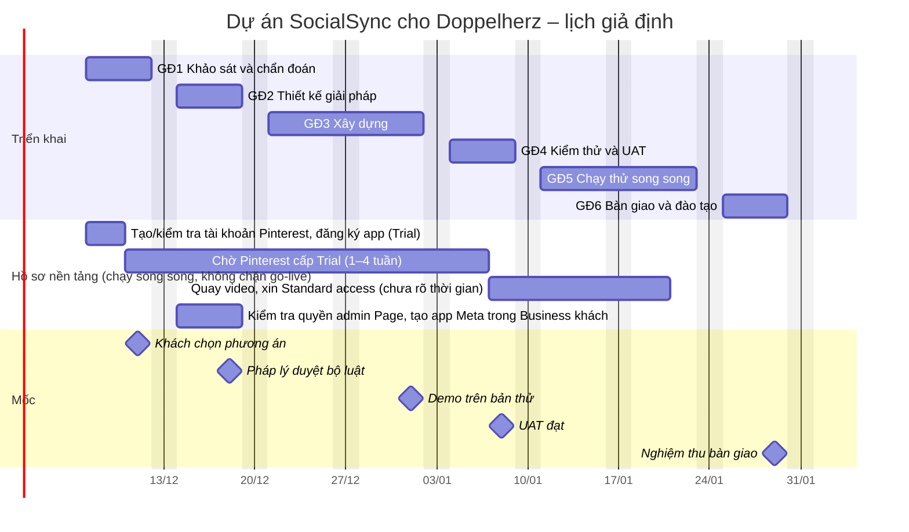

# 2.2 Kế hoạch triển khai – Hệ thống đồng bộ nội dung Website → Facebook + Pinterest

**Khách hàng:** Doppelherz Việt Nam (CTCP Mastertran) · **Ngày lập:** 19/11/2026 · **Đi kèm:** 2.1 Chẩn đoán hiện trạng, 2.3 Báo giá, 2.4 Sơ đồ quy trình

**Nhãn:** [Suy luận] = ước tính của chúng tôi, chưa có số đo. [Chưa xác minh] = chưa kiểm được, phải thử hoặc hỏi.

Kế hoạch này viết cho **phương án đề xuất** trong báo giá. Phương án tối thiểu dùng cùng lịch 8 tuần, ít ngày công hơn (khác biệt ở mục 9).

---

## 1. Tóm tắt

| Mục | Nội dung |
|---|---|
| Mục tiêu | Bài đăng lên doppelherz.vn được tự động phân loại, viết lại cho Facebook và Pinterest, kiểm tra tuân thủ, **chờ người duyệt**, rồi đăng theo lịch. Có nhật ký và báo cáo tuần |
| Thời gian triển khai | **8 tuần**: từ khảo sát đến nghiệm thu bàn giao |
| Vận hành sau bàn giao | 3 tháng bảo hành + 9 tháng bảo trì (năm đầu) |
| Ngày bắt đầu giả định | Thứ Hai 07/12/2026 → bàn giao 29/01/2027 [Suy luận: trước Tết Nguyên đán 2027, chưa kiểm ngày Tết chính xác] |
| Công phía đối tác | **20,5 ngày công**: PM/Tư vấn 8 · Kỹ sư tự động hóa 11 · Thiết kế 1,5 |
| Công cụ chính | WordPress (website sẵn có), plugin SocialSync, n8n tự host trên VPS, Claude API, Facebook Graph API, Make.com (cầu nối Pinterest), Google Sheets |
| Nguyên tắc | Không có chế độ "đăng thẳng". Mọi bài qua người duyệt. Bộ luật tuân thủ là file cấu hình người phụ trách pháp lý quảng cáo (khách chỉ định) [Giả định] sửa được |

---

## 2. Bản demo giúp rút ngắn những gì

Bản demo đã chạy thật tại https://shop.adaptivealgo.uk và https://n8n.adaptivealgo.uk (đo ngày 19/11/2026).

| Thành phần | Trạng thái demo | Việc còn lại trong dự án thật |
|---|---|---|
| Plugin WordPress: bắt sự kiện xuất bản, chống đăng trùng, gửi nền, nhật ký, đồng bộ lại, log, UTM | Đã chạy | Cài lên website khách (qua bản thử) |
| Chặn bài theo danh mục / thông báo PDF; phân loại E/P/N/X bằng Claude | Đã chạy (đã thử trên bài thật của doppelherz.vn, không đăng) | Chỉnh danh mục chặn theo khách; đo độ chính xác trên bộ 20 bài mẫu |
| n8n: Claude viết nội dung 2 kênh trong 1 lần gọi, kiểm tra độ dài và cụm từ cấm, mẫu dự phòng, câu khuyến cáo do code gắn | Đã chạy | Thêm tra sổ XNQC, bộ luật do người phụ trách pháp lý duyệt, lớp rà soát thứ hai |
| Màn hình duyệt: sửa nội dung, chọn giờ, duyệt / đăng ngay / từ chối, chống duyệt trùng | Đã chạy | Hai lớp duyệt cho nhóm nhạy cảm; nhắc việc duyệt |
| Lịch đăng tự rải (khung giờ, tối đa/ngày, khoảng cách) + giờ chọn tay trên bài | Đã chạy | Lịch nội dung trên Google Sheet nếu khách cần |
| Facebook qua Graph API | Đã chạy, lên bài sau ~7 giây | Tạo app trong Meta Business của khách, thêm quyền đọc tương tác |
| Pinterest qua Make.com | Đã chạy, Pin công khai, đúng giờ đặt (1 phút → 62 giây) | Kết nối tài khoản Pinterest của khách |
| Luồng báo lỗi riêng; trang Báo cáo + báo cáo tuần do Claude tóm tắt | Đã chạy | Gửi báo cáo qua email; thêm GA4 |
| Ảnh Pin dọc 2:3 | Chưa có | Làm mới trong dự án |

**Tác động lên kế hoạch [Suy luận]:**
- Giai đoạn xây dựng còn khoảng **8 ngày công kỹ sư (2 tuần lịch)**, thay vì ước tính 15–17 ngày công nếu làm từ đầu.
- Hai rủi ro kỹ thuật lớn nhất đã gỡ: đăng Facebook bằng API, và tạo Pin **công khai** khi app Pinterest riêng chưa được duyệt.
- Giai đoạn thiết kế dùng lại trạng thái, cấu trúc dữ liệu và prompt của demo, chỉ bổ sung phần tuân thủ.
- Demo đã có thêm màn hình duyệt, phân loại, lịch tự rải và báo cáo (cập nhật tối 19/11/2026). Ngày công kỹ sư vẫn giữ 11 ngày: phần tiết kiệm được dồn cho việc đưa lên website thật, tra sổ XNQC, lớp rà soát thứ hai và kiểm thử cùng người phụ trách pháp lý [Suy luận].

---

## 3. Các giai đoạn, mốc, đầu ra và tiêu chí nghiệm thu

| GĐ | Tên | Tuần (lịch giả định) | Ngày công đối tác | Đầu ra | Tiêu chí nghiệm thu |
|---|---|---|---|---|---|
| 1 | Khảo sát và chẩn đoán | Tuần 1 (07–11/12/2026) | PM 2 | Biên bản khảo sát; sơ đồ quy trình hiện tại có bấm giờ; bảng phân loại E/P/N/X; phạm vi chốt và báo giá chính thức | Đầu mối marketing ký biên bản và chọn phương án |
| 2 | Thiết kế giải pháp | Tuần 2 (14–18/12) | PM 2, KS 1 | Tài liệu thiết kế: luồng, trạng thái, luồng duyệt; bộ luật tuân thủ (file cấu hình); prompt bản 1; phác thảo 3 mẫu ảnh Pin; kế hoạch kiểm thử và bộ 20 bài mẫu | Marketing duyệt luồng và mẫu; **người phụ trách pháp lý duyệt bộ luật và danh sách từ cấm** |
| 3 | Xây dựng | Tuần 3–4 (21/12/2026–01/01/2027) | KS 8, TK 1,5 | VPS + n8n chạy HTTPS, có sao lưu; plugin trên bản thử của website; luồng n8n đầy đủ; mẫu ảnh Pin dựng tự động; lịch nội dung + báo cáo tuần | Buổi demo cuối tuần 4: một bài mỗi loại E/P/N/X chạy đúng từ đầu đến cuối trên bản thử |
| 4 | Kiểm thử và UAT | Tuần 5 (04–08/01/2027) | PM 0,5, KS 1 | Biên bản UAT với 20 bài mẫu và các ca lỗi | Đạt toàn bộ tiêu chí ở mục 3.1 |
| 5 | Chạy thử song song | Tuần 6–7 (11–22/01/2027) | PM 1, KS 0,5 | Tuần 6: hệ thống chạy trên website thật, chỉ tạo nội dung chờ duyệt, không đăng. Tuần 7: bật đăng thật sau khi duyệt | Đạt tiêu chí ở mục 3.2 |
| 6 | Bàn giao | Tuần 8 (25–29/01/2027) | PM 1, KS 0,5 | Đào tạo 2 buổi; tài liệu vận hành; chuyển toàn bộ tài khoản và mật khẩu cho khách; thu hồi quyền của đối tác | Biên bản nghiệm thu bàn giao |
| – | Quản lý dự án (xuyên suốt) | Tuần 1–8 | PM 1,5 | Họp tuần, báo cáo tuần, theo dõi hồ sơ Meta/Pinterest | – |
| 7 | Vận hành: bảo hành | 3 tháng sau nghiệm thu (02–04/2027) | Trong giá | Sửa lỗi theo tiêu chí nghiệm thu | Thời gian phản hồi ≤ 1 ngày làm việc |
| 7 | Vận hành: bảo trì | Tháng 4–12 sau nghiệm thu (05/2027–01/2028) | Gói tháng | Kiểm tra định kỳ, cập nhật, xử lý sự cố | Báo cáo bảo trì hằng tháng |

**Tổng công đối tác:** PM 2 + 2 + 0,5 + 1 + 1 + 1,5 = **8**; KS 1 + 8 + 1 + 0,5 + 0,5 = **11**; TK **1,5**. Tổng **20,5 ngày công**, khớp báo giá 2.3.

Chi tiết 8 ngày công kỹ sư ở giai đoạn 3: hạ tầng 1 · plugin 2 · luồng n8n 3 · ảnh Pin 1 · lịch nội dung và báo cáo tuần 1.

### 3.1 Tiêu chí nghiệm thu UAT (giai đoạn 4)

Bộ 20 bài mẫu lấy từ bài thật của doppelherz.vn: 10 bài E, 5 bài P, 3 bài N, 2 bài X; thêm các ca lỗi.

| # | Tiêu chí | Ngưỡng đạt |
|---|---|---|
| 1 | Bài loại X (thông báo đại lý, tin nội bộ) bị chặn, nhật ký ghi lý do | 100% |
| 2 | Bài loại P: công dụng đúng nguyên văn sổ XNQC, có cụm "Thực phẩm bảo vệ sức khỏe", câu khuyến cáo và số XNQC | 100% |
| 3 | Từ trong danh sách cấm; con số không có trong bài gốc | 0 |
| 4 | Bài lên kênh khi chưa được duyệt | 0 |
| 5 | Bài đăng trùng (kể cả khi sửa bài, bấm Đăng nhiều lần) | 0 |
| 6 | Nội dung người duyệt chấm "đăng được, không sửa hoặc sửa nhẹ" | ≥ 80% [Suy luận – mục tiêu, chốt với khách ở giai đoạn 2] |
| 7 | Ca lỗi: tắt Claude → dùng mẫu và ghi rõ; tắt n8n → báo thất bại, đồng bộ lại được; token sai → báo lỗi nguyên văn | Đúng cả 3 ca |
| 8 | Ảnh Pin 1000×1500 hiển thị đúng tiếng Việt có dấu, đúng mẫu | 100% bài có ảnh |
| 9 | Bài đăng đúng khung giờ đã xếp | Lệch ≤ 5 phút |
| 10 | Báo cáo tuần: số liệu khớp trang nhật ký | Khớp 100% |

### 3.2 Tiêu chí nghiệm thu chạy song song (giai đoạn 5)

- 2 tuần không có lỗi nghiêm trọng: bài sai nội dung lên kênh, đăng trùng, bài chưa duyệt lên kênh.
- ≥ 95% lượt đã duyệt đăng thành công. Lượt lỗi còn lại có lý do rõ và đồng bộ lại được.
- Người duyệt dùng được màn hình duyệt mà không cần đối tác hỗ trợ trực tiếp trong tuần 7.
- Đo lại thời gian xử lý một bài, so với số đo "trước" ở giai đoạn 1.

---

## 4. Sơ đồ thời gian

Ghi chú:
- Ngày 01/01/2027 là ngày nghỉ. Giai đoạn 3 cần 8 ngày công kỹ sư trong 9 ngày làm việc, nên vẫn kịp.
- **Pinterest không nằm trên đường găng.** Hệ thống chạy thật qua Make.com (đã chứng minh trong demo). Nếu Pinterest cấp Standard access, có thể chuyển sang API riêng bằng cách thay một khối trong n8n (xem mục 8, rủi ro R1).
- **Đường găng thật** là hai việc phía khách: quyền admin fanpage (tuần 2) và người phụ trách pháp lý duyệt bộ luật (cuối tuần 2).

---

## 5. Nhân sự

### 5.1 Phía đối tác

| Vai trò | Nhiệm vụ chính | Ngày công |
|---|---|---|
| PM / Tư vấn giải pháp | Dẫn khảo sát, chẩn đoán, thiết kế luồng và luồng duyệt, soạn bộ luật tuân thủ cùng người phụ trách pháp lý, viết prompt, điều phối UAT, đào tạo, báo cáo tiến độ | 8 |
| Kỹ sư tự động hóa | VPS, n8n, bảo mật, sao lưu; chỉnh plugin WordPress (PHP); luồng n8n; dựng ảnh Pin tự động; báo cáo; xử lý lỗi | 11 |
| Thiết kế đồ họa | 3 mẫu ảnh Pin (bố cục A câu hỏi, B dải tiêu đề, C sản phẩm) theo nhận diện thương hiệu | 1,5 |
| **Tổng** | | **20,5** |

### 5.2 Phía khách hàng (không tính phí, cần cam kết thời gian)

| Vai trò | Nhiệm vụ | Thời gian ước tính [Suy luận] |
|---|---|---|
| Đầu mối marketing | Ra quyết định phạm vi, duyệt thiết kế, nghiệm thu, dự họp tuần | ~3 ngày trong 8 tuần |
| Người duyệt nội dung (+ 1 người dự phòng) | Duyệt bộ bài mẫu ở UAT; duyệt bài trong chạy song song và vận hành | ~2 ngày trong dự án; sau đó vài phút mỗi bài |
| Người phụ trách pháp lý quảng cáo (khách chỉ định) [Giả định] | Duyệt bộ luật, danh sách từ cấm, sổ XNQC; duyệt lớp 2 cho bài P và nhóm nhạy cảm | ~1 ngày trong dự án |
| Bên quản trị website (nội bộ hoặc thuê ngoài) [Chưa xác minh] | Bản thử website, cài plugin lên website thật, DNS tên miền phụ, mở tường lửa Cloudflare nếu cần | ~1,5 ngày |
| Quản trị fanpage / Meta Business | Cấp quyền, tạo app Meta cùng kỹ sư | ~0,5 ngày |
| Người đứng tên tài khoản dịch vụ | Mở tài khoản VPS, Claude API, Make; nhập thẻ thanh toán | ~0,5 ngày |

---

## 6. Công cụ

| Công cụ | Mục đích | Chi phí | Ai trả |
|---|---|---|---|
| WordPress + WooCommerce (sẵn có) | Nguồn nội dung | 0đ (đang dùng) | – |
| Plugin SocialSync (đối tác viết) | Bắt sự kiện xuất bản, chống trùng, màn hình duyệt, nhật ký | Nằm trong công triển khai; bàn giao mã nguồn | – |
| n8n Community, tự host | Lõi xử lý: AI, kiểm tra, lịch, đăng, báo cáo | 0đ phần mềm (bản Community miễn phí) | – |
| VPS trong nước 2 vCPU / 4 GB RAM / 40 GB SSD | Chạy n8n | ~264.000đ/tháng gồm VAT (Bizfly Cloud gói VPS 4: 240.000đ chưa VAT, tra 19/11/2026) | Khách, trả thẳng nhà cung cấp |
| Claude API (model claude-opus-5-5) | Viết nội dung theo kênh, rà soát | Theo token: $4/1 triệu token vào, $20/1 triệu token ra (tra 19/11/2026). Ngân sách trần $10/tháng | Khách, trả thẳng Anthropic |
| Facebook Graph API | Đăng bài lên fanpage | 0đ | – |
| Make.com gói Free | Cầu nối tạo Pin công khai | 0đ (1.000 credits/tháng) | Khách sở hữu tài khoản |
| Pinterest API (nếu được Standard access) | Thay Make về sau | 0đ | – |
| Google Sheets | Lịch nội dung, báo cáo tuần | 0đ (dùng tài khoản Google sẵn có của khách) [Suy luận] | – |
| Google Analytics 4 (nếu website có) | Đo lượt truy cập theo UTM | 0đ | – |
| Cloudflare (website đang dùng) | HTTPS, tên miền phụ cho n8n | 0đ thêm [Suy luận] | – |
| GitHub (kho riêng) | Lưu mã plugin và file luồng n8n, không chứa khóa bí mật | 0đ | Đối tác, chuyển cho khách khi bàn giao |
| Trello hoặc Google Sheet + nhóm Zalo | Quản lý việc, trao đổi hằng ngày | 0đ | – |
| OBS / công cụ quay màn hình | Video xin Pinterest Standard access, video hướng dẫn | 0đ | – |

Giá và nguồn chi tiết ở tài liệu 2.3.

---

## 7. Ma trận RACI

R = thực hiện · A = chịu trách nhiệm cuối, phê duyệt · C = được hỏi ý kiến · I = được thông báo

| Hoạt động | PM đối tác | KS đối tác | TK đối tác | Đầu mối MKT | Người duyệt ND | Pháp lý (khách chỉ định) | Quản trị website (nội bộ/thuê ngoài) | Ban giám đốc |
|---|---|---|---|---|---|---|---|---|
| Khảo sát, chẩn đoán | R | C | – | A | C | C | C | I |
| Chốt phạm vi, báo giá, hợp đồng | R | C | – | A | – | – | – | C |
| Tài khoản Pinterest, app Meta | C | R | – | A | – | – | C | – |
| Bảng phân loại E/P/N/X | R | C | – | A | C | C | – | – |
| Bộ luật tuân thủ, danh sách từ cấm | R | C | – | C | C | **A** | – | I |
| Prompt và mẫu nội dung | R | C | – | A | C | C | – | – |
| Mẫu ảnh Pin | A | C | R | C | – | C | – | – |
| VPS, n8n, bảo mật, sao lưu | A | R | – | I | – | – | C | – |
| Cài plugin lên website | A | R | – | I | – | – | C | – |
| UAT | R | R | – | A | R | C | – | – |
| Duyệt bài hằng ngày | I | – | – | A | R | R (bài P, nhóm nhạy cảm) | – | – |
| Đào tạo, tài liệu | R | R | – | A | I | I | I | – |
| Nghiệm thu bàn giao | R | C | – | A | C | C | C | I |
| Vận hành, xử lý lỗi sau bàn giao | C | R | – | A | I | – | C | – |
| Thanh toán dịch vụ (VPS, Claude, Make) | I | C | – | A, R* | – | – | – | – |

\* Người đứng tên và thanh toán tài khoản dịch vụ (Kế toán hoặc Marketing) chốt ở khảo sát [Giả định].

---

## 8. Rủi ro và phương án

| # | Rủi ro | Khả năng | Ảnh hưởng | Phương án |
|---|---|---|---|---|
| R1 | Pinterest chậm cấp Trial/Standard access | Cao | Không dùng được API riêng | Go-live bằng Make.com (đã chứng minh trong demo). Chuyển sang API riêng khi được cấp; làm miễn phí nếu được cấp trong thời gian bảo hành |
| R2 | Kết nối Pinterest của Make lỗi (người dùng Make báo lỗi 401/403 từ 09/2025 [Nguồn]) | Trung bình | Pin không lên | Luồng báo lỗi đánh dấu thất bại ngay; nút đồng bộ lại; dự phòng: xuất "gói Pin" (ảnh, tiêu đề, mô tả, link) để đăng tay |
| R3 | Fanpage không do khách quản trị đầy đủ (agency giữ), hoặc phải xác minh doanh nghiệp Meta | Trung bình | Chậm 1–3 tuần [Nguồn] | Hỏi ngay ở buổi khảo sát (B5.1, B5.2); làm hồ sơ từ tuần 1 |
| R4 | Người phụ trách pháp lý phản hồi chậm bộ luật | Trung bình | Chậm cả dự án | Gửi bản nháp bộ luật ngay sau khảo sát; hẹn lịch duyệt cố định cuối tuần 2; bộ luật là file cấu hình nên sửa sau được |
| R5 | AI viết sai ý hoặc thêm công dụng | Trung bình | Phạt 20–40 triệu/lỗi [Nguồn], ảnh hưởng thương hiệu | Ba lớp: prompt ràng buộc → cổng tuân thủ (luật cứng + rà soát) → người duyệt. Bài P chỉ lắp ghép từ sổ XNQC |
| R6 | Người duyệt quá tải hoặc vắng, bài tồn đọng | Trung bình | Bài lên chậm | Người dự phòng; nhắc việc khi bài chờ quá hạn; khung giờ đăng có chừa thời gian duyệt |
| R7 | Dựng ảnh Pin bằng n8n lỗi font tiếng Việt có dấu | Trung bình [Suy luận – chưa thử] | Ảnh Pin xấu | Thử ngay đầu giai đoạn 3; phương án lùi: dùng ảnh đại diện như demo |
| R8 | VPS hoặc n8n ngừng chạy | Thấp | Bài không được đồng bộ | Cảnh báo lượt kẹt (đã có trong demo); sao lưu hằng ngày; nút đồng bộ lại |
| R9 | Token Facebook hết hạn hoặc bị thu hồi quyền | Trung bình | Facebook ngừng đăng | Dùng token dài hạn; nhật ký ghi lỗi nguyên văn; quy trình cấp lại token trong tài liệu vận hành [Chưa xác minh loại token phù hợp nhất cho Business khách] |
| R10 | Quy định quảng cáo thay đổi trong năm | Trung bình | Bộ luật lỗi thời | Bộ luật tách khỏi code; người phụ trách pháp lý sửa được; rà soát trong gói bảo trì |
| R11 | Chi phí Claude vượt dự kiến | Thấp | Vượt ngân sách vận hành | Đặt hạn mức chi tiêu trên tài khoản Claude; ghi số token từng lượt; có thể đổi sang model rẻ hơn |
| R12 | Lịch rơi vào cuối năm và trước Tết | Trung bình | Thiếu người phía khách | Chốt lịch người duyệt và người phụ trách pháp lý ngay buổi khảo sát; nếu chậm, lùi chạy song song sang sau Tết |
| R13 | Lộ khóa API, token | Thấp | Mất an toàn tài khoản | Khóa lưu trong kho credential của n8n; không ghi vào code, log; đổi toàn bộ mật khẩu và thu hồi quyền đối tác khi bàn giao |

---

## 9. Phương án tối thiểu khác gì

| Hạng mục | Phương án đề xuất | Phương án tối thiểu |
|---|---|---|
| Lọc E/P/N/X, tra sổ XNQC, người duyệt, hai lớp duyệt nhóm nhạy cảm | Có | Có (không cắt, vì là yêu cầu tuân thủ) |
| Ảnh Pin dọc 2:3 theo mẫu | Có | Không – dùng ảnh đại diện như demo |
| Lịch nội dung trên Google Sheet | Có | Không – dùng khung giờ cố định cấu hình trong n8n |
| Báo cáo tuần | Có, kèm lượt truy cập theo UTM nếu có GA4 | Có, chỉ đếm từ nhật ký |
| Ngày công | 20,5 (PM 8, KS 11, TK 1,5) | 16 (PM 6,5, KS 9,5) |
| Lịch | 8 tuần | 8 tuần (giai đoạn 3 nhẹ hơn, các giai đoạn khác giữ nguyên vì phụ thuộc phía khách) |

---

## 10. Báo cáo tiến độ

| Hình thức | Tần suất | Nội dung | Người nhận |
|---|---|---|---|
| Họp tiến độ 30 phút (trực tuyến) | Thứ Hai hằng tuần | Đã làm, sắp làm, rủi ro, việc cần khách quyết | Đầu mối MKT; mời người phụ trách pháp lý / bên quản trị website khi cần |
| Báo cáo tuần 1 trang | Thứ Sáu hằng tuần | Tiến độ theo mốc (đúng/chậm), ngày công đã dùng, rủi ro mở, quyết định chờ | Đầu mối MKT, Ban giám đốc (I) |
| Bảng theo dõi việc (Trello hoặc Google Sheet) | Cập nhật hằng ngày | Từng việc, người làm, hạn, trạng thái | Cả nhóm hai bên |
| Nhóm Zalo dự án | Khi cần | Hỏi nhanh; báo ngay việc bị chặn | Cả nhóm |
| Báo rủi ro chặn tiến độ | Trong 24 giờ kể từ khi phát hiện | Mô tả, ảnh hưởng, phương án đề xuất | Đầu mối MKT |
| Demo cuối giai đoạn | Cuối GĐ 2, 3, 5 | Chạy thật trước mặt khách | Đầu mối MKT, người duyệt |
| Báo cáo bảo trì | Hằng tháng (từ tháng 4) | Số lượt đồng bộ, lỗi, sự cố đã xử lý, đề xuất | Đầu mối MKT |

---

## Nguồn

- Đề bài: `Bai_test_Quan_ly_du_an_AI.docx.md`, Câu 2.
- Chẩn đoán và câu hỏi khảo sát: `nop-bai/02-1-chan-doan-hien-trang.md`. Sơ đồ quy trình demo và bản chính thức: `nop-bai/04-so-do-quy-trinh.md`.
- Nghiên cứu doppelherz.vn (đo 19/11/2026): `research/01_phan_tich_de_bai.md`, `research/02_template_3_kenh_va_huong_prototype.md`, `research/HANDOFF.md`.
- Thiết kế bản demo: `SocialSync-Brief.md`, `SocialSync-PRD.md` (mục 4, 7.5, 12–18).
- Pinterest access tiers: https://developers.pinterest.com/docs/key-concepts/access-tiers ; thời gian chờ và lỗi kết nối Make: community.pinterest.biz, community.make.com (theo `SocialSync-Brief.md` mục 8).
- Facebook Graph API: https://developers.facebook.com/docs/graph-api/reference/page/feed
- n8n Community miễn phí: https://docs.n8n.io/hosting/community-edition-features/ (tra 19/11/2026).
- Giá VPS: https://bizflycloud.vn/cloud-server/bang-gia (tra 19/11/2026). Giá Claude API: https://platform.claude.com/docs/en/about-claude/pricing (tra 19/11/2026). Make Free 1.000 credits/tháng: https://www.make.com/en/pricing (tra 19/11/2026).
