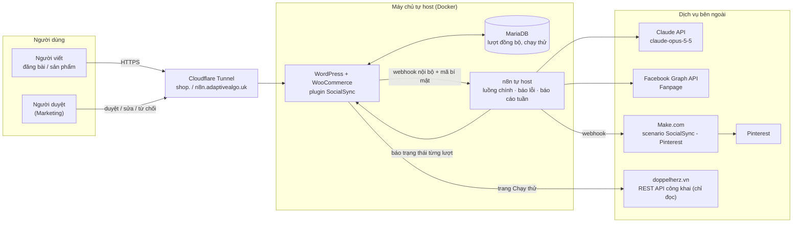
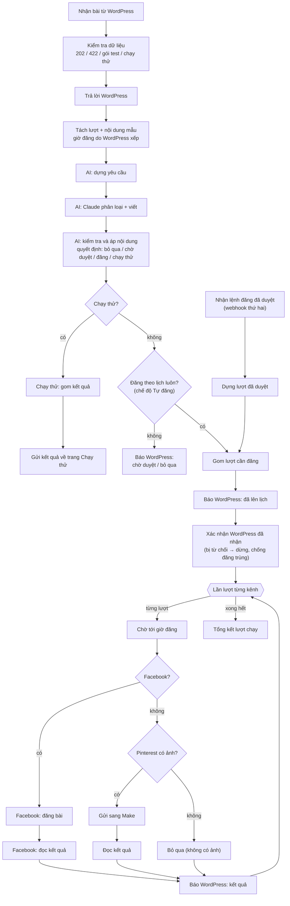
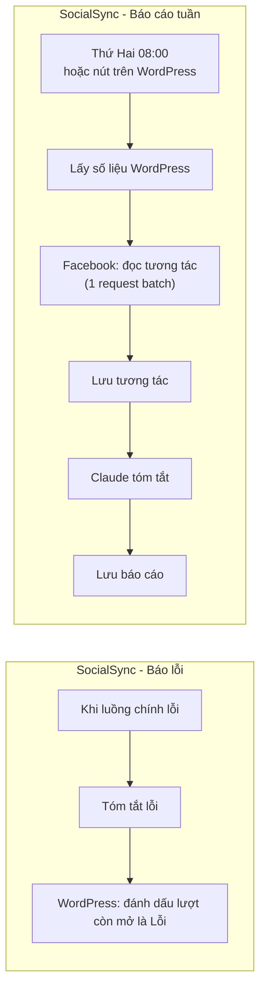
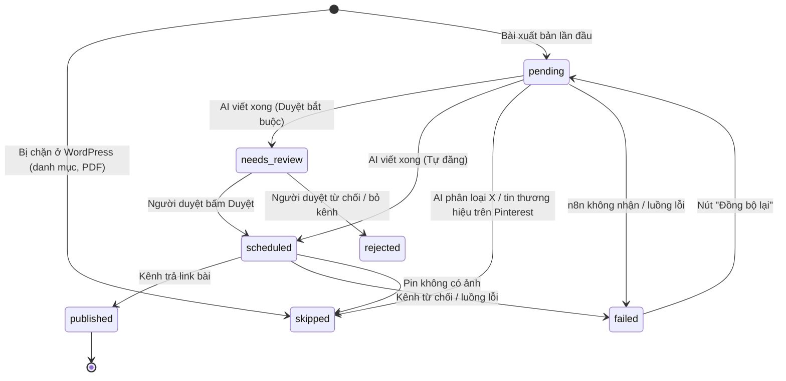
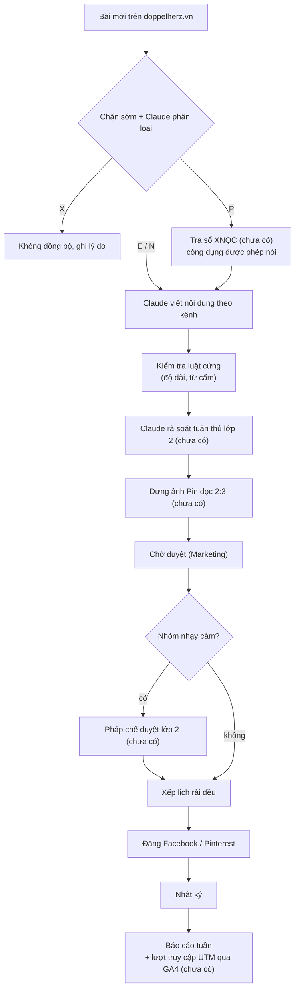

# 2.4 Sơ đồ quy trình hệ thống SocialSync

Tài liệu có hai phần:
- **Phần A – Bản demo đang chạy thật.** Mọi sơ đồ khớp với code và luồng n8n đã triển khai tại `shop.adaptivealgo.uk` và `n8n.adaptivealgo.uk`. Các con số là số đo ngày 19/11/2026.
- **Phần B – Bản chính thức đề xuất cho Doppelherz.** Gồm những bước còn thiếu so với demo: tra sổ xác nhận quảng cáo, rà soát tuân thủ lớp hai, ảnh Pin dọc, hai lớp duyệt. Đây là phạm vi của dự án thật trong kế hoạch và báo giá.

Sơ đồ viết bằng Mermaid: GitHub và VS Code hiển thị trực tiếp thành hình.

---

## Phần A – Bản demo đang chạy thật

### A1. Kiến trúc tổng thể



Điểm thiết kế chính:
- **Plugin WordPress lo phần con người cần nhìn và bấm.** Nhật ký, màn hình duyệt, lịch đăng, báo cáo, chạy thử. **n8n lo phần máy làm:** gọi AI, kiểm tra, chờ giờ, đăng, đọc tương tác. Sửa quy trình đăng không phải sửa website.
- **WordPress và n8n gọi nhau qua mạng nội bộ Docker**, có header `X-SocialSync-Secret`, và mọi bước dùng chung một mã yêu cầu nên truy được bài nào đi qua đâu.
- **Pinterest đi qua Make.com.** App Pinterest API riêng mới ở mức Trial: Pin chỉ người tạo thấy, và việc xét duyệt mất 1–4 tuần. Kết nối có sẵn của Make tạo được Pin công khai, đã kiểm tra bằng cách mở Pin khi không đăng nhập.

### A2. Một bài đi qua hệ thống (chế độ mặc định: Duyệt bắt buộc)

```mermaid
sequenceDiagram
  autonumber
  actor U as Người viết
  participant WP as WordPress (plugin)
  participant N as n8n
  participant C as Claude
  actor R as Người duyệt
  participant F as Facebook
  participant M as Make → Pinterest

  U->>WP: Bấm "Đăng"
  WP->>WP: Chặn sớm? (danh mục bị chặn, tiêu đề .pdf) → Bỏ qua, không gọi AI
  WP->>WP: Tạo 1 lượt mỗi kênh + xếp giờ đăng<br/>(khung giờ, tối đa/ngày, cách nhau ≥ 30 phút)
  WP-->>U: Trả trang ngay (gửi nền 1–2 ms)
  WP->>N: Dữ liệu bài + giờ đăng + chế độ duyệt
  N->>C: 1 lần gọi: phân loại E/P/N/X + viết nội dung 2 kênh
  C-->>N: JSON
  N->>N: Kiểm tra độ dài, từ cấm; gắn khuyến cáo (loại P), giá, link UTM
  N->>WP: Từng lượt: "Chờ duyệt" (hoặc "Bỏ qua" nếu X / N trên Pinterest)
  R->>WP: Xem, sửa nội dung, chọn giờ → Duyệt
  WP->>WP: Khóa lượt (chỉ đổi nếu còn "Chờ duyệt")
  WP->>N: Lệnh đăng đã duyệt
  N->>N: Chờ tới giờ đăng của từng kênh
  N->>F: Đăng ảnh + nội dung
  N->>WP: Facebook: "Đã đăng" + link
  N->>M: Tiêu đề, mô tả, ảnh, link, board
  M-->>N: pin_id
  N->>WP: Pinterest: "Đã đăng" + link Pin
```

Số đo:
- **Không có bước duyệt** (bài #66): Facebook lên sau 7 giây; Pinterest đặt trễ 1 phút, lên sau 62 giây.
- **Có bước duyệt** (bài #74): tài khoản người chấm bấm "Duyệt và đăng ngay", cả hai kênh lên trong vòng 20 giây.
- **Claude:** 5–17 giây cho mỗi lần gọi.

### A3. Luồng n8n chính (28 khối, hai đường vào)



Hai luồng phụ:



### A4. Vòng đời một lượt đồng bộ



Ba lớp chống đăng trùng:
1. Khóa duy nhất (bài, kênh) trong cơ sở dữ liệu.
2. Nút Duyệt chỉ đổi lượt còn ở "Chờ duyệt", bằng câu UPDATE có điều kiện. Đã thử bấm duyệt lần hai: bị chặn.
3. n8n chỉ đăng khi WordPress chấp nhận chuyển lượt sang "Đã lên lịch".

### A5. Màn hình trong WordPress (menu SocialSync)

| Màn hình | Ai dùng | Làm gì |
|---|---|---|
| **Nhật ký đồng bộ** | Quản lý cửa hàng, Biên tập, Quản trị | Mỗi lượt một dòng: trạng thái, phân loại, người duyệt, nội dung, link bài, tương tác, link lần chạy n8n; cảnh báo lượt kẹt; nút Đồng bộ lại |
| **Chờ duyệt (số bài)** | Như trên | Danh sách bài chờ duyệt → màn hình duyệt từng bài |
| **Báo cáo** | Như trên | 7/30 ngày: tỉ lệ thành công từng kênh, thời gian lên kênh, AI hay mẫu, chi phí AI ước tính, số bài theo ngày, tương tác cao nhất, báo cáo tuần do Claude tóm tắt |
| **Chạy thử doppelherz.vn** | Như trên | Đưa 3/5/10 bài thật mới nhất qua đúng luồng AI, không đăng |
| **Cấu hình** | Chỉ Quản trị | Chế độ duyệt, khung giờ, tối đa/ngày, khoảng cách, danh mục chặn, câu khuyến cáo, board Pinterest, webhook, mã xác minh Pinterest, mức log |
| Ô **Lịch đăng mạng xã hội** trong màn hình viết bài | Người viết | Chọn giờ riêng cho từng kênh, để trống thì tự xếp |

Wireframe màn hình duyệt:

```
┌─────────────────────────────────────────────────────────────────────────┐
│ Duyệt nội dung: Omega-3 và sức khỏe tim mạch: ăn cá bao nhiêu là đủ?    │
│ Phân loại: Kiến thức — Bài chia sẻ kiến thức dinh dưỡng, không giới…    │
│ Nguồn nội dung: Claude viết (claude-opus-5-5, 1 lần gọi cho 2 kênh)     │
├─────────────────────────────────────────────────────────────────────────┤
│ [x] Facebook Fanpage                                                    │
│  ⚠ Cảnh báo: có cụm từ quảng cáo sức khỏe rủi ro: … (nếu có)            │
│  ┌───────────────────────────────────────────────────────────────────┐  │
│  │ Ăn cá bao nhiêu mỗi tuần là đủ để bổ sung omega-3? 🐟 …            │  │
│  │ 👉 Xem chi tiết: https://…?utm_source=facebook …                   │  │
│  └───────────────────────────────────────────────────────────────────┘  │
│  Giờ đăng [ 19/11/2026 20:04 ]  (bộ xếp lịch đề xuất)                   │
├─────────────────────────────────────────────────────────────────────────┤
│ [x] Pinterest   Tiêu đề [ … ]  Mô tả [ … ]  Alt [ … ]  Board: …        │
│  Giờ đăng [ 19/11/2026 20:04 ]                                          │
├─────────────────────────────────────────────────────────────────────────┤
│ [ Duyệt và đăng theo giờ đã chọn ]  [ Duyệt và đăng ngay ]              │
│ Lý do từ chối [ …………… ]            [ Từ chối toàn bộ ]                 │
└─────────────────────────────────────────────────────────────────────────┘
```

---

## Phần B – Bản chính thức đề xuất cho Doppelherz

Các bước ghi "(chưa có)" là phần demo chưa làm.



| Bước | Demo (đã chạy) | Bản chính thức (thêm) |
|---|---|---|
| Chọn bài | Chặn theo danh mục, PDF; Claude phân loại E/P/N/X | Danh mục chặn theo cấu trúc của doppelherz.vn; đo độ chính xác phân loại trên 20 bài mẫu |
| Nội dung | Claude viết từ bài gốc, cấm từ rủi ro, khuyến cáo do code gắn | Tra sổ XNQC cho bài sản phẩm; rà soát tuân thủ lớp 2; bộ luật là file pháp chế sửa được |
| Duyệt | Một lớp, sửa được nội dung và giờ, chống duyệt trùng | Hai lớp cho nhóm nhạy cảm (hiện chỉ gắn cờ); nhắc việc duyệt qua email |
| Ảnh Pinterest | Ảnh đại diện có sẵn | Ảnh dọc 1000×1500 theo 3 bố cục |
| Lịch | Tự rải theo khung giờ, số bài/ngày, khoảng cách; giờ chọn tay | Lịch nội dung trên Google Sheet nếu khách cần |
| Báo cáo | Trang Báo cáo + báo cáo tuần do Claude tóm tắt | Thêm GA4 (lượt truy cập theo UTM); tương tác Facebook cần app có quyền `pages_read_user_content`; số liệu Pin cần API Pinterest riêng |

## Nguồn
- Code và luồng đang chạy: `plugin/social-sync/`, `n8n/workflows/socialsync-main.json`, `socialsync-error.json`, `socialsync-report.json` trong repo https://github.com/jinsimple/doppelherz-social
- Số đo: nhật ký `logs/social-sync.log`, bảng `wp_socialsync_jobs`, ngày 19/11/2026
- Khảo sát doppelherz.vn và lưu ý ngành: `research/01_phan_tich_de_bai.md`, `research/02_template_3_kenh_va_huong_prototype.md`
