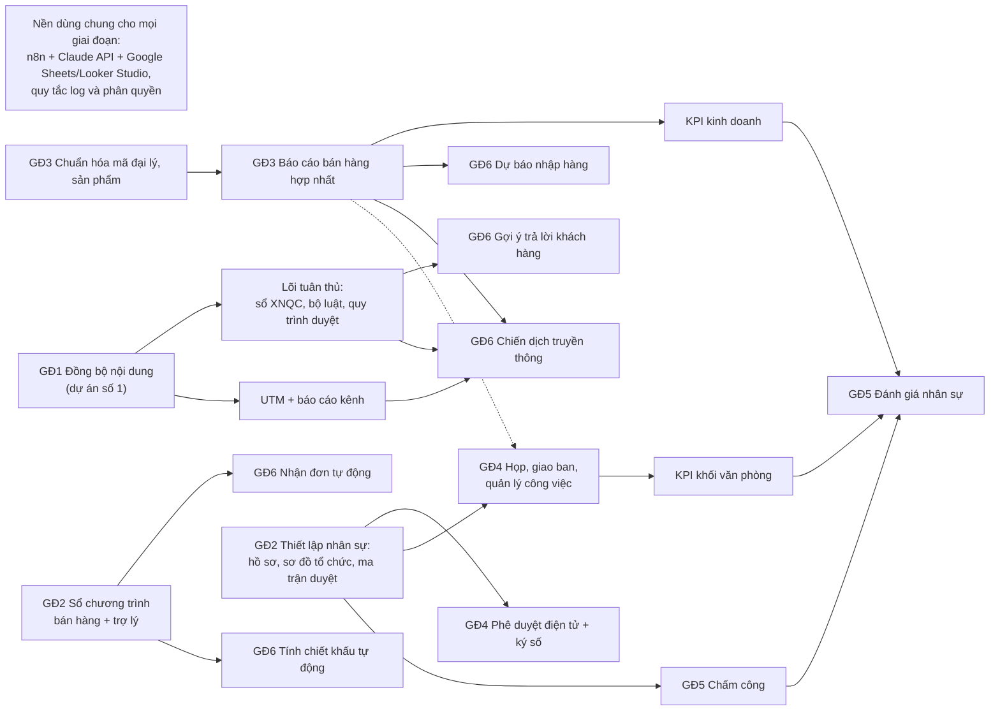

# 2.7 Lộ trình mở rộng sau dự án đồng bộ nội dung

Ngày lập: 19/11/2026. Người lập: ứng viên vị trí Quản lý dự án AI.

**Nhãn.** **[Suy luận]**: ước tính hoặc nhận định chưa được doanh nghiệp xác nhận. **[Chưa xác minh]**: thông tin từ nguồn thứ cấp, chưa kiểm tra. Mọi ngân sách trong tài liệu là khoảng ước tính **[Suy luận]** để ban giám đốc hình dung quy mô. Số chính thức sẽ báo giá theo từng giai đoạn sau khảo sát. Mốc thời gian giả định dự án số 1 khởi động tháng 01/2027.

## Tóm tắt

Dự án số 1 (đồng bộ nội dung Website → Facebook, Pinterest) là dự án tạo niềm tin. Theo tôi, nhu cầu lớn hơn của công ty là số hóa vận hành nội bộ: các gợi ý trong đề (nhân sự, giao ban, ký duyệt, chấm công) đều thuộc nhóm này **[Suy luận]**. Lộ trình đi theo nguyên tắc **dữ liệu nền trước, quy trình sau, đánh giá con người sau cùng**:

| Giai đoạn | Thời gian | Nội dung chính | Ngân sách triển khai **[Suy luận]** |
|---|---|---|---|
| GĐ1 | Q1/2027 | Dự án số 1: đồng bộ nội dung có cổng tuân thủ. Khảo sát nội bộ và đo hiện trạng | 40–50 triệu (theo báo giá Câu 2) |
| GĐ2 | Q2/2027 | Sổ chương trình bán hàng và trợ lý tra cứu. Song song: thiết lập dữ liệu nhân sự | 30–80 triệu |
| GĐ3 | Q3/2027 | Báo cáo bán hàng hợp nhất và cảnh báo cận hạn dùng. Song song: chọn nền tảng văn phòng số | 50–100 triệu |
| GĐ4 | Q4/2027 | Vận hành nội bộ: phê duyệt điện tử, ký số văn bản, họp và giao ban | 50–120 triệu + bản quyền |
| GĐ5 | Q1–Q2/2028 | Chấm công và đánh giá nhân sự | 40–100 triệu + thiết bị, bản quyền |
| GĐ6 | Từ Q2/2028 | Tăng trưởng: chiến dịch truyền thông, gợi ý trả lời khách hàng, nhận đơn và tính chiết khấu tự động, dự báo nhập hàng | Báo giá theo từng hạng mục |

Giai đoạn 1–3 chính là 3 hạng mục ưu tiên ở Câu 1, theo đúng thứ tự. Mỗi giai đoạn có một "cổng": chỉ sang giai đoạn sau khi giai đoạn trước đạt chỉ số đã thống nhất và ban chỉ đạo duyệt. Không ký trước ngân sách cho cả lộ trình.

---

## 1. Vì sao theo thứ tự này

Đề gợi ý thứ tự: thiết lập nhân sự → vận hành → họp và giao ban → ký duyệt văn bản → đánh giá và chấm công → chạy chiến dịch truyền thông. Tôi giữ gần như nguyên thứ tự đó cho khối nội bộ. Tôi chỉ chèn hai dự án dữ liệu bán hàng (GĐ2, GĐ3) vào trước, vì bốn lý do:

1. **Phải có dữ liệu trước khi đánh giá.** Muốn chấm KPI nhân viên kinh doanh một cách công bằng thì phải có số bán hàng tự động, đáng tin (GĐ3). Muốn chấm KPI khối văn phòng thì phải có hệ thống giao việc (GĐ4). Chấm công và đánh giá vì thế đứng sau cùng.
2. **Phải có sơ đồ tổ chức trước khi số hóa phê duyệt.** Phần mềm phê duyệt cần biết "ai duyệt cho ai, đến mức tiền nào". Vì vậy "thiết lập nhân sự" bắt đầu sớm ở GĐ2, chạy song song, do HCNS chủ trì. Việc này chủ yếu là công sức nội bộ, ít tốn tiền.
3. **Thay đổi toàn công ty cần vốn niềm tin.** Phê duyệt điện tử và chấm công đổi thói quen của mọi người. Nên làm sau khi Marketing, lực lượng bán hàng và ban giám đốc đã thấy ba kết quả cụ thể.
4. **Chiến dịch truyền thông cần số đo.** Dự án số 1 bắt đầu gắn UTM. Phải có 2–3 quý dữ liệu UTM và số bán hàng (GĐ3) thì mới đo được chiến dịch nào ra đơn. Chiến dịch cũng có rủi ro quảng cáo cao hơn đăng bài thường. Vì vậy nó nằm ở GĐ6, dùng lại lõi tuân thủ của dự án số 1.

Nếu ban giám đốc muốn số hóa nội bộ sớm hơn, có thể đổi chỗ GĐ3 và GĐ4. GĐ4 chỉ phụ thuộc phần thiết lập nhân sự ở GĐ2, không phụ thuộc báo cáo bán hàng.

| Gợi ý trong đề | Nằm ở | Ghi chú |
|---|---|---|
| Thiết lập nhân sự | GĐ2 (song song) | Hồ sơ nhân sự, sơ đồ tổ chức, chức danh, ma trận phê duyệt |
| Vận hành | GĐ3–GĐ4 | Bán hàng: GĐ2–3. Nội bộ: quy trình chuẩn và quản lý công việc ở GĐ4 |
| Họp và giao ban | GĐ4 | Biên bản AI, giao việc có hạn, dùng số liệu tự động của GĐ3 |
| Ký duyệt văn bản | GĐ4 | Phê duyệt điện tử + chữ ký số |
| Đánh giá và chấm công nhân sự | GĐ5 | Cần dữ liệu của GĐ2, GĐ3, GĐ4 |
| Chạy chiến dịch truyền thông | GĐ6 | Cần UTM của GĐ1 và số bán hàng của GĐ3 |

## 2. Bản đồ phụ thuộc

Đọc sơ đồ: mũi tên A → B nghĩa là B cần A xong trước. Nét đứt: giao ban dùng số liệu của báo cáo bán hàng nhưng không bị chặn nếu báo cáo chưa xong. Nếu đổi chỗ GĐ3 và GĐ4 thì giao ban chạy trước với số liệu gom tay.

## 3. Chi tiết từng giai đoạn

### GĐ1 – Q1/2027: Dự án số 1 và đo hiện trạng

- **Hạng mục:** (a) Dự án đồng bộ nội dung có cổng tuân thủ (Câu 2, ưu tiên 1 ở Câu 1). (b) Trong lúc khảo sát cho dự án số 1, phỏng vấn thêm trưởng 7 phòng ban để chấm lại bảng ưu tiên Câu 1 bằng số thật. (c) Đo hiện trạng (baseline), mỗi chỉ số đo 1–2 tuần: số giờ gom báo cáo bán hàng, số cuộc gọi hỏi chương trình tới admin, thời gian duyệt một đề xuất, số ngày tổng hợp công. (d) Việc nhanh không cần dự án: gắn UTM, bật tự tải hóa đơn đầu vào nếu phần mềm kế toán có sẵn tính năng.
- **Sản phẩm bàn giao:** hệ thống chạy thật, tài liệu vận hành, bảng ưu tiên Câu 1 đã chấm lại, bảng số đo hiện trạng.
- **Ngân sách:** 40–50 triệu kèm phí vận hành, theo báo giá Câu 2.
- **Cổng sang GĐ2:**
  - Hệ thống đã chạy thật ≥ 4 tuần. 0 bài vi phạm quy định quảng cáo lên kênh.
  - ≥ 90% bài AI soạn được duyệt mà không phải sửa nội dung pháp lý **[Suy luận – ngưỡng đề xuất]**.
  - Marketing tự vận hành, không cần người triển khai túc trực.
  - Ban chỉ đạo duyệt bảng ưu tiên đã chấm lại và bảng số đo hiện trạng.

### GĐ2 – Q2/2027: Sổ chương trình bán hàng + thiết lập nhân sự

- **Hạng mục chính (ưu tiên 2 ở Câu 1):** số hóa các thông báo chương trình thành bảng có cấu trúc; trợ lý tra cứu qua Zalo/Teams cho nhân viên kinh doanh 4 kênh và Dịch vụ bán hàng; gửi chương trình mới đúng đối tượng đại lý qua Zalo OA.
- **Hạng mục song song – thiết lập nhân sự:** chuẩn hóa hồ sơ nhân sự (mã nhân viên duy nhất, phòng ban, chức danh, quản lý trực tiếp, vùng phụ trách), sơ đồ tổ chức, ma trận phê duyệt (loại đề xuất × hạn mức × người duyệt). HCNS chủ trì, người quản lý dự án AI cung cấp mẫu và kiểm tra chất lượng dữ liệu. Giai đoạn đầu dùng Google Sheets có kiểm tra định dạng. Chưa mua phần mềm.
- **Ngân sách:** 30–60 triệu cho sổ chương trình + 0–20 triệu cho thiết lập nhân sự (chủ yếu công sức nội bộ). Vận hành 1–3 triệu/tháng (API, máy chủ, tin ZNS) **[Suy luận]**. Giá tin ZNS được một nguồn thứ cấp nêu khoảng 200–250 đồng/tin **[Chưa xác minh]**.
- **Cổng sang GĐ3:**
  - ≥ 95% câu trả lời đúng trên bộ 100 câu hỏi kiểm thử do Dịch vụ bán hàng soạn.
  - ≥ 70% nhân viên kinh doanh dùng trợ lý ít nhất 1 lần/tuần sau 4 tuần.
  - Cuộc gọi hỏi chương trình tới admin giảm ≥ 50% so với số đo GĐ1.
  - ≥ 95% hồ sơ nhân sự đủ trường bắt buộc. Ban giám đốc ký ban hành sơ đồ tổ chức và ma trận phê duyệt.

### GĐ3 – Q3/2027: Báo cáo bán hàng hợp nhất

- **Hạng mục chính (ưu tiên 3 ở Câu 1):** lấy dữ liệu tự động từ ERP/DMS và từ sàn TMĐT; chuẩn hóa mã đại lý và mã sản phẩm; bảng điều khiển trên Looker Studio hoặc Power BI; AI viết tóm tắt biến động gửi trước giờ giao ban.
- **Mở rộng trên cùng đường dữ liệu:** cảnh báo lô cận hạn dùng cho Kho và Kinh doanh (KHO-1 ở Câu 1).
- **Song song:** lập yêu cầu và so sánh 2–3 nền tảng văn phòng số cho GĐ4: MISA AMIS, Base, 1Office, hoặc mở rộng Google Workspace/Microsoft 365 mà công ty đang dùng. Chọn trước khi hết quý.
- **Ngân sách:** 40–80 triệu cho báo cáo + 10–20 triệu cho cảnh báo cận hạn dùng. Vận hành 0,5–3 triệu/tháng **[Suy luận]**.
- **Điều kiện bắt đầu:** khảo sát GĐ1 xác nhận ERP/DMS xuất được dữ liệu. Nếu không xuất được, làm cảnh báo cận hạn dùng trước và đưa việc "mở đường dữ liệu" (làm việc với nhà cung cấp ERP) thành hạng mục riêng.
- **Cổng sang GĐ4:**
  - Số tự động khớp ≥ 99% với số Kế toán chốt cuối tháng, 2 tháng liên tiếp.
  - Báo cáo gửi đúng giờ ≥ 95% số ngày. Được dùng trong giao ban của ban giám đốc.
  - Kế toán trưởng ký văn bản định nghĩa chỉ số doanh số.
  - Đã chọn nền tảng văn phòng số; ban chỉ đạo duyệt ngân sách GĐ4.

### GĐ4 – Q4/2027: Vận hành nội bộ (phê duyệt, ký số, họp và giao ban)

- **Hạng mục:**
  - Phê duyệt điện tử cho 5–7 loại đề xuất phổ biến nhất (nghỉ phép, tạm ứng, công tác phí, mua sắm, đề xuất chương trình bán hàng), theo ma trận phê duyệt từ GĐ2.
  - Ký số văn bản nội bộ trước. Sau đó ký hợp đồng và biên bản đối chiếu với đại lý, nếu pháp chế đồng ý.
  - Họp và giao ban: ghi âm → AI viết biên bản → danh sách việc có người phụ trách và hạn → nhắc việc tự động. Giao ban sáng dùng báo cáo của GĐ3.
  - Quy trình chuẩn (SOP) của 3–5 quy trình hay lỗi nhất được đưa lên hệ thống quản lý công việc.
- **Cách triển khai:** thử với 1–2 phòng trong 4 tuần (gợi ý: Kế toán và Dịch vụ bán hàng, nơi có nhiều đề xuất), rồi mới mở toàn công ty. Có giai đoạn chạy song song giấy và điện tử, ngày kết thúc do ban giám đốc ấn định.
- **Ngân sách:** triển khai 50–120 triệu **[Suy luận]**. Bản quyền tham khảo: gói MISA AMIS Văn phòng số Enterprise được nhà cung cấp niêm yết khoảng 160.000 đồng/người/tháng **[Chưa xác minh – bài viết có ghi lẫn năm 2024]**, tức khoảng 16 triệu/tháng cho mỗi 100 người dùng. Nếu dùng Google Workspace/Microsoft 365 sẵn có kèm AppSheet/Power Automate thì bản quyền thấp hơn nhưng công dựng cao hơn. Chứng thư chữ ký số tính phí theo năm **[Chưa xác minh giá]**.
- **Cổng sang GĐ5:**
  - ≥ 80% đề xuất thuộc 5–7 loại đã chọn đi qua hệ thống. Thời gian duyệt trung vị giảm ≥ 50% so với số đo GĐ1.
  - ≥ 90% biên bản giao ban có danh sách việc kèm người phụ trách và hạn.
  - Khảo sát người dùng: ≥ 70% thấy nhanh hơn cách cũ.

### GĐ5 – Q1–Q2/2028: Chấm công và đánh giá nhân sự

- **Hạng mục:**
  - Chấm công: máy chấm công tại văn phòng, kho; chấm công GPS hoặc check-in tại điểm bán cho nhân viên thị trường; tự động đẩy dữ liệu công sang bảng lương.
  - Đánh giá: KPI kinh doanh lấy từ báo cáo GĐ3 (doanh số, độ phủ, đại lý mới); KPI khối văn phòng lấy từ hệ thống giao việc GĐ4 (đúng hạn, khối lượng). AI chỉ tổng hợp và viết nháp nhận xét. Người quản lý trực tiếp quyết định điểm.
- **Nguyên tắc bắt buộc:** chạy song song với cách cũ 2 kỳ lương trước khi dùng thật. Quy chế KPI và chấm công phải được ban hành và thông báo cho người lao động trước. Không để AI tự quyết định lương, thưởng, kỷ luật. Dữ liệu vị trí chỉ thu trong giờ làm việc, có thông báo và đồng ý của người lao động theo quy định bảo vệ dữ liệu cá nhân **[Chưa xác minh chi tiết văn bản áp dụng, cần pháp chế]**.
- **Ngân sách:** triển khai 40–100 triệu + thiết bị chấm công + bản quyền phần mềm chấm công/lương **[Suy luận]**.
- **Đo thành công:** chênh lệch công giữa hệ thống và cách cũ < 1% và có giải thích; thời gian tổng hợp công/tháng giảm ≥ 60% so với số đo GĐ1; số khiếu nại về công giảm; ≥ 90% nhân viên có KPI tự động cập nhật hằng tháng.

### GĐ6 – Từ Q2/2028: Tăng trưởng

Thứ tự trong GĐ6 xếp theo điểm ở Câu 1 và theo điều kiện đã có:

| Thứ tự | Hạng mục | Điều kiện đã có | Ngân sách **[Suy luận]** |
|---|---|---|---|
| 1 | Chạy chiến dịch truyền thông: lập kế hoạch theo nhóm khách hàng, sinh nội dung qua lõi tuân thủ, đo bằng UTM + số bán hàng | UTM từ GĐ1 (≥ 2 quý dữ liệu), báo cáo bán hàng GĐ3 | 30–60 triệu |
| 2 | Gợi ý trả lời tin nhắn khách hàng (fanpage, Zalo OA, chat sàn), nhân viên bấm gửi | Lõi tuân thủ GĐ1 đã chạy ổn ≥ 2 quý | 40–80 triệu |
| 3 | Nhận đơn đại lý tự động + tính chiết khấu tự động | Sổ chương trình GĐ2, mã chuẩn GĐ3, API ERP | 80–200 triệu (phụ thuộc ERP) |
| 4 | Dự báo nhu cầu để đặt hàng nhập khẩu | ≥ 2 năm dữ liệu bán hàng sạch từ GĐ3 | 60–120 triệu |

## 4. Tổng ngân sách và chỉ số

**Ngân sách triển khai năm đầu (GĐ1–GĐ4):** khoảng 170–350 triệu, chưa gồm bản quyền văn phòng số **[Suy luận]**. Mỗi giai đoạn được báo giá và duyệt riêng tại cổng. Công ty có thể dừng sau bất kỳ giai đoạn nào mà vẫn giữ được hệ thống đã làm.

Ba nguyên tắc giữ chi phí thấp:

1. Dùng lại một nền (n8n, Claude API, Sheets/Looker) cho GĐ1–GĐ3.
2. Ưu tiên phần mềm công ty đã trả tiền.
3. Dữ liệu luôn xuất được ra ngoài, để không phụ thuộc một nhà cung cấp.

**Chỉ số theo dõi chương trình** (báo cáo tháng cho ban chỉ đạo):

| Nhóm | Chỉ số | Nguồn số |
|---|---|---|
| Thời gian | Số giờ tiết kiệm/tháng so với số đo GĐ1, theo từng hạng mục | Số đo hiện trạng + log hệ thống + khảo sát nhanh người dùng |
| Chất lượng | Số lỗi nghiêm trọng (vi phạm quảng cáo, báo sai chương trình, sai công) | Sổ sự cố |
| Sử dụng | Tỉ lệ người dùng hoạt động hằng tuần trên mỗi hệ thống | Log |
| Tốc độ | Thời gian duyệt đề xuất; thời gian bài web lên social; giờ có báo cáo bán hàng | Log |
| Kinh doanh | Lượt truy cập và đơn có UTM; tỉ lệ đại lý tái đặt hàng (từ GĐ6) | GA4, báo cáo bán hàng |
| Chi phí | Chi phí vận hành thực tế/tháng so với dự toán | Hóa đơn nhà cung cấp |

## 5. Quản trị chương trình

### 5.1 Vai trò

| Vai trò | Ai **[Suy luận – đề xuất]** | Quyết định gì |
|---|---|---|
| Nhà tài trợ (sponsor) | Một thành viên ban giám đốc | Duyệt ngân sách từng giai đoạn, mở cổng, giải quyết xung đột ưu tiên giữa các phòng |
| Ban chỉ đạo | Sponsor + trưởng các phòng có dự án đang chạy + Kế toán trưởng + người quản lý dự án AI | Duyệt phạm vi, xếp lại ưu tiên mỗi quý |
| Chủ nghiệp vụ (mỗi dự án) | Trưởng phòng hưởng lợi: Marketing (GĐ1), Kinh doanh/Dịch vụ bán hàng (GĐ2), Kinh doanh + Kế toán (GĐ3), HCNS (GĐ4–5) | Duyệt yêu cầu, nghiệm thu, cử người dùng thử |
| Pháp chế / người phụ trách hồ sơ quảng cáo | Bộ phận đang duyệt nội dung quảng cáo **[Chưa xác minh công ty có pháp chế riêng]** | Duyệt bộ luật tuân thủ (GĐ1, GĐ6), quy chế dữ liệu nhân sự (GĐ5) |
| Quản lý dự án AI | Ứng viên | Lập kế hoạch, điều phối nhà cung cấp, kiểm soát chất lượng, báo cáo, chuyển giao |
| Quản trị hệ thống | IT nội bộ hoặc đơn vị thuê ngoài | Tài khoản, phân quyền, sao lưu, khóa bí mật |

### 5.2 Nhịp báo cáo

| Nhịp | Hình thức | Nội dung |
|---|---|---|
| Hằng tuần | Báo cáo 1 trang gửi sponsor và chủ nghiệp vụ | Đã xong, tuần tới, rủi ro, quyết định cần có |
| 2 tuần/lần | Buổi demo 30 phút với người dùng | Cho xem sản phẩm thật, lấy góp ý |
| Hằng tháng | Họp ban chỉ đạo 60 phút | Bảng chỉ số mục 4, chi phí, sổ rủi ro |
| Mỗi cổng giai đoạn | Họp nghiệm thu | Đối chiếu chỉ số với cổng, quyết định đi tiếp, điều chỉnh hoặc dừng |
| Hằng quý | Rà soát lộ trình | Chấm lại bảng ưu tiên Câu 1 bằng số thật, chốt kế hoạch quý sau |

Tài liệu dùng chung: sổ quyết định, sổ rủi ro, sổ sự cố, nhật ký thay đổi, tài liệu vận hành của từng hệ thống.

### 5.3 Quy tắc chung cho mọi dự án

- Mỗi quý, mỗi nhóm người dùng chỉ gánh một thay đổi lớn, để tránh quá tải.
- Con người duyệt mọi đầu ra của AI có tác động ra bên ngoài (nội dung quảng cáo, tin nhắn khách hàng) hoặc lên quyền lợi người lao động (công, KPI).
- Dữ liệu cá nhân (nhân viên, khách hàng, bác sĩ) chỉ đưa vào AI khi cần, qua gói dịch vụ doanh nghiệp không dùng dữ liệu để huấn luyện **[Chưa xác minh điều khoản hiện hành]**, và theo quy định bảo vệ dữ liệu cá nhân.
- Mỗi hệ thống có ít nhất hai người nội bộ biết vận hành, có tài liệu và ghi log. Không để phụ thuộc một người, kể cả người quản lý dự án.

## 6. Rủi ro cấp chương trình

| Rủi ro | Giảm thiểu |
|---|---|
| Dự án số 1 không đạt cổng, mất niềm tin cho cả lộ trình | Cổng đo bằng chỉ số đã thống nhất từ đầu. Nếu chưa đạt thì sửa trong tối đa 4 tuần trước khi mở GĐ2 |
| ERP/DMS không xuất được dữ liệu, GĐ3 bị chặn | Phát hiện ngay ở khảo sát GĐ1. Có phương án đổi thứ tự (mục GĐ3) |
| Người dùng không dùng hệ thống mới | Chủ nghiệp vụ cam kết từ đầu; thử ở phòng nhỏ trước; đo tỉ lệ sử dụng hằng tuần |
| Quy định quảng cáo TPBVSK thay đổi | Bộ luật là file cấu hình do pháp chế cập nhật, không viết cứng trong code |
| Chi phí vận hành tăng dần qua các năm | Theo dõi chi phí tháng so với dự toán; dùng lại nền chung; dữ liệu xuất được để có thể đổi nhà cung cấp |
| Người lao động phản đối chấm công và KPI tự động | Ban hành quy chế trước, chạy song song 2 kỳ, AI không tự quyết định |

## Nguồn

- Đề bài: `Bai_test_Quan_ly_du_an_AI.docx.md`, Câu 2 mục 7.
- Câu 1 của bài nộp (3 hạng mục ưu tiên, bảng chấm điểm, giả định lợi ích): `nop-bai/01-cau-1-khao-sat-tu-dong-hoa.md`.
- Nghiên cứu: `research/01_phan_tich_de_bai.md` (nhận định nhu cầu số hóa nội bộ, mục 1); `research/02_template_3_kenh_va_huong_prototype.md` (lưu ý ngành TPBVSK, mục 4); `research/doppelherz_posts_12thang.csv` (46 thông báo chương trình bán hàng).
- Dự án số 1: `SocialSync-Brief.md`, `nop-bai/04-so-do-quy-trinh.md`, `nop-bai/06-san-pham-chay-that.md`.
- Giá tham khảo MISA AMIS Văn phòng số: https://amis.misa.vn/?p=91695 **[Chưa xác minh]**.
- Giá tham khảo tin Zalo ZNS (nguồn thứ cấp): https://cellphones.com.vn/sforum/zalo-thu-phi-nguoi-dung **[Chưa xác minh]**.
- Các khoảng ngân sách còn lại là ước tính của ứng viên **[Suy luận]**, chưa có báo giá của nhà cung cấp.
