# Hướng dẫn từng bước: từ lúc viết bài đến lúc bài lên Facebook và Pinterest

Tài liệu này đi qua **một lần chạy thật**, chụp màn hình từng bước. Lần chạy làm lúc 10:36–10:37 ngày 20/11/2026 trên bản demo, bằng tài khoản người chấm (quyền *Quản lý cửa hàng*), ở chế độ mặc định **Duyệt bắt buộc**.

- **Bài dùng để chạy:** bài thật *"Sắc đẹp phụ nữ – Vẻ đẹp bền vững bắt đầu từ sức khỏe bên trong"* trên doppelherz.vn (danh mục Làm đẹp, đăng 07/04/2026). Chúng tôi lấy nguyên tiêu đề, nội dung chữ và ảnh đại diện. Cuối bài có dòng ghi nguồn.
- **Kết quả:** bài lên Fanpage sau **7 giây** và Pin lên board **Làm đẹp** sau **11 giây**, tính từ lúc bấm duyệt. Tổng thời gian từ lúc bấm Đăng tới lúc cả hai kênh có bài: khoảng **41 giây**.
- **Cách chụp:** ảnh chụp bằng trình duyệt Edge chạy tự động. Ở bước tải ảnh và dán nội dung, script làm thay thao tác chuột (tải ảnh vào Thư viện, dán chữ), kết quả trên màn hình giống người làm tay.

| Mốc | Giờ | Ghi chú |
|---|---|---|
| Bấm Đăng trên website | 10:36:46 | Hệ thống tạo 2 lượt (Facebook, Pinterest) |
| Claude phân loại và viết xong | ~10:37:07 | 21 giây sau khi bấm Đăng; 1 lần gọi AI cho cả 2 kênh |
| Bấm "Duyệt và đăng ngay" | 10:37:16 | Duyệt nguyên văn, không sửa |
| Bài lên Facebook | 10:37:23 | Công khai, xem được khi không đăng nhập |
| Pin lên Pinterest | 10:37:27 | Board "Làm đẹp" (theo danh mục của bài) |

---

## Bước 1. Đăng nhập

Mở https://shop.adaptivealgo.uk/wp-admin và đăng nhập bằng tài khoản được cấp.

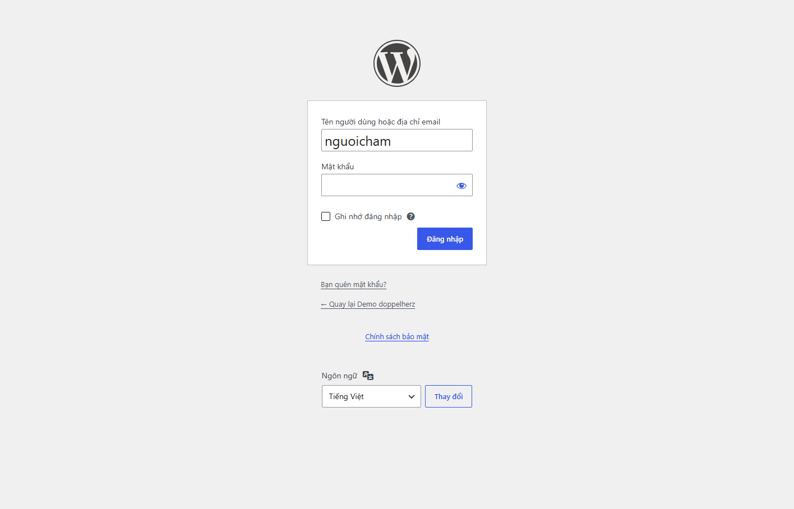

## Bước 2. Viết bài mới: tiêu đề, nội dung, ảnh đại diện, danh mục

Vào **Bài viết → Viết bài mới**.

1. Nhập **tiêu đề** và **nội dung** như viết bài bình thường.
2. Ở cột phải, mục **Ảnh đại diện**: chọn ảnh. **Pinterest bắt buộc có ảnh**; không có ảnh thì chỉ Facebook đăng (dạng bài kèm link).
3. Mục **Danh mục**: tick **Làm đẹp**. Danh mục quyết định Pin vào board nào (*Làm đẹp → board Làm đẹp*, còn lại → board *Sức khoẻ & Dinh dưỡng*).

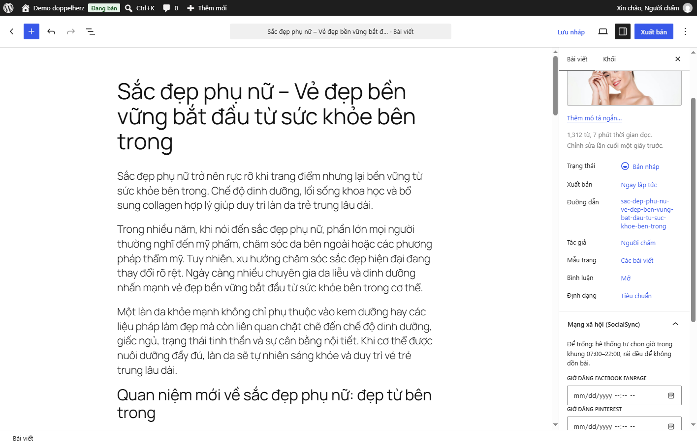

## Bước 3. (Tùy chọn) Chọn giờ đăng trong bảng "Mạng xã hội (SocialSync)"

Cũng ở cột phải có bảng **Mạng xã hội (SocialSync)** với ô giờ đăng cho từng kênh.

- **Để trống** (như lần chạy này): hệ thống tự xếp giờ trong khung 07:00–22:00, tối đa 10 bài/ngày mỗi kênh, cách nhau ít nhất 30 phút.
- **Chọn giờ**: kênh đó đăng đúng giờ bạn chọn (sau khi được duyệt).

Dòng cuối bảng cho biết chế độ đang chạy: *Duyệt bắt buộc* nghĩa là nội dung AI viết sẽ chờ người duyệt.

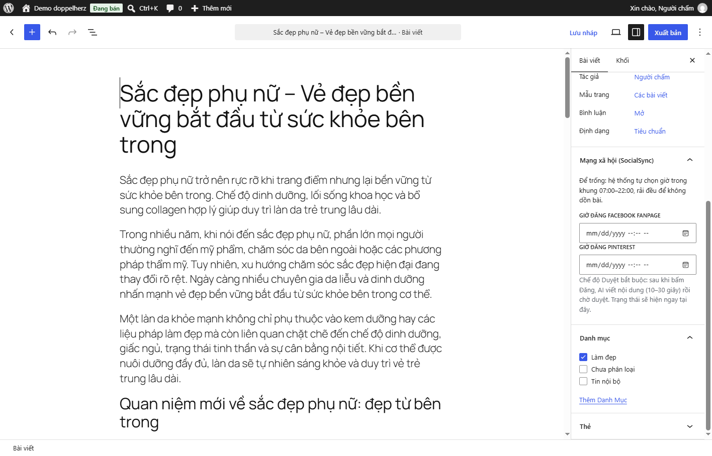

## Bước 4. Bấm Xuất bản

Bấm **Xuất bản** ở góc trên bên phải, rồi bấm **Xuất bản** lần nữa trong bảng xác nhận của WordPress.

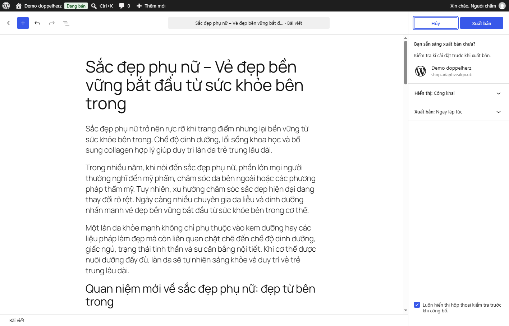

## Bước 5. Không cần rời trang: bảng tự báo trạng thái

Ngay sau khi xuất bản, bảng **Mạng xã hội (SocialSync)** đổi thành *"Đã gửi sang AI. Khoảng 10–30 giây nữa nội dung sẽ chờ duyệt…"*.

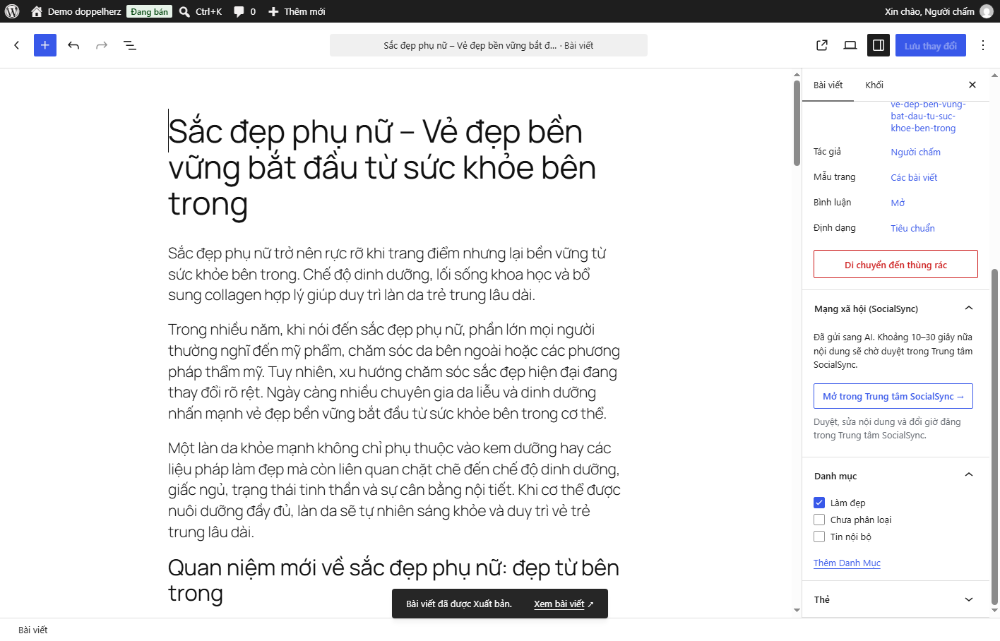

Bảng tự hỏi lại hệ thống mỗi 10 giây. Lần này, 21 giây sau, bảng hiện **Facebook Fanpage: Chờ duyệt** và **Pinterest: Chờ duyệt**, kèm nút **Mở trong Trung tâm SocialSync →**.

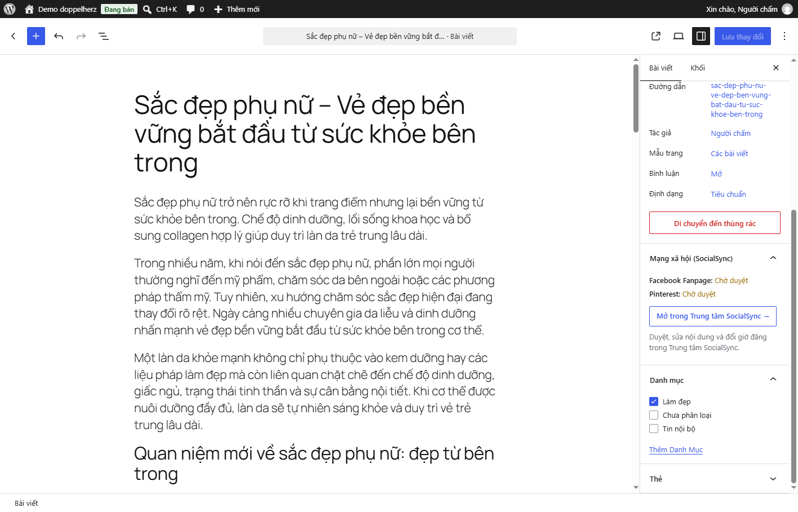

## Bước 6. Mở Trung tâm SocialSync để duyệt

Bấm **Mở trong Trung tâm SocialSync →** (hoặc vào menu **SocialSync**; số đỏ cạnh menu là số bài chờ duyệt).

Trung tâm chia đôi:
- **Bên trái:** danh sách bài, mỗi bài có trạng thái từng kênh (FB, Pin). Tab *Cần duyệt* mở sẵn.
- **Bên phải:** bài đang chọn:
  - **Phân loại** của Claude kèm lý do. Lần này là *Kiến thức*: "Bài chia sẻ kiến thức làm đẹp từ bên trong về collagen, dinh dưỡng và lối sống, không giới thiệu sản phẩm cụ thể nào".
  - **Nguồn nội dung:** Claude viết, 1 lần gọi cho 2 kênh, AI viết trong 14,3 giây.
  - **Ảnh đại diện** sẽ dùng cho Pin.

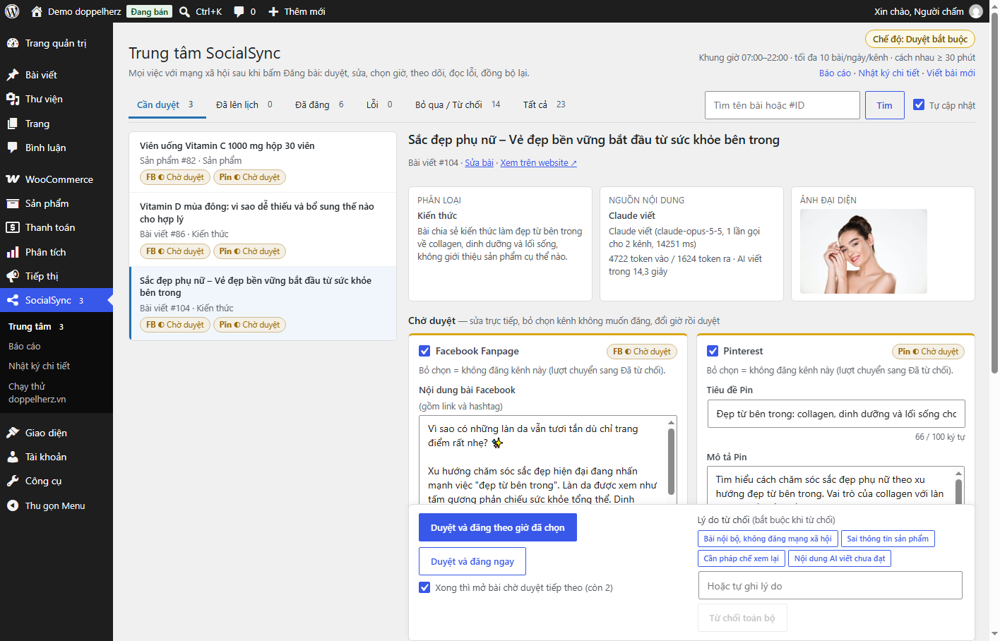

Kéo xuống là phần **nội dung từng kênh**, sửa trực tiếp được:
- **Facebook:** nội dung bài (có đếm ký tự, link về bài gốc gắn mã theo dõi UTM, hashtag), giờ đăng.
- **Pinterest:** tiêu đề Pin, mô tả, mô tả ảnh (alt), **board: Làm đẹp**, giờ đăng.
- Nếu nội dung có cụm từ quảng cáo sức khỏe rủi ro (ví dụ "chữa khỏi", "100%"), khung vàng cảnh báo hiện ngay, kể cả khi bạn đang gõ.

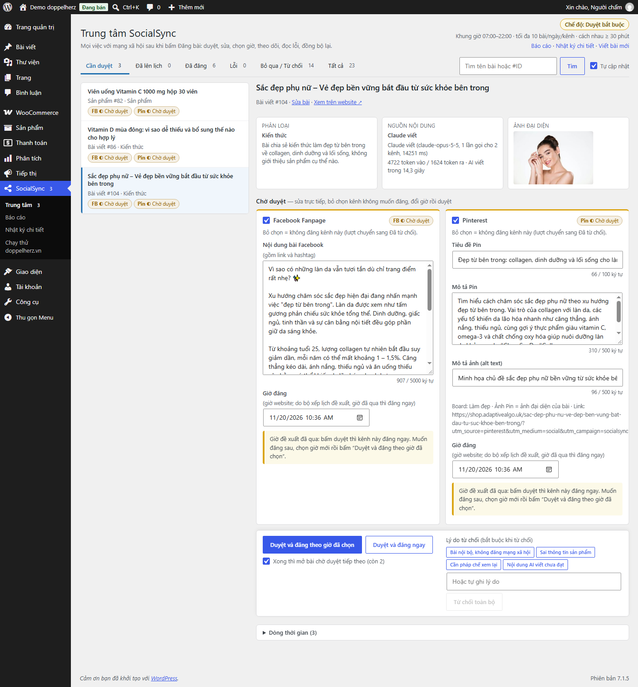

## Bước 7. Duyệt

Thanh hành động ở cuối có ba lựa chọn:
- **Duyệt và đăng theo giờ đã chọn:** đăng theo giờ trong ô giờ của từng kênh.
- **Duyệt và đăng ngay:** đăng liền (lần chạy này chọn nút này).
- **Từ chối toàn bộ:** chọn lý do nhanh hoặc tự ghi; nút chỉ bấm được khi đã có lý do.

Ô *Xong thì mở bài chờ duyệt tiếp theo* (mặc định tick) giúp duyệt nhiều bài liên tục. Lần này bỏ tick để ở lại xem kết quả.

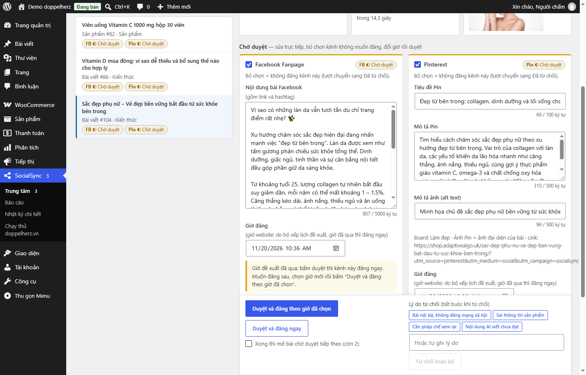

## Bước 8. Theo dõi ngay tại Trung tâm

Sau khi duyệt, thông báo xanh xác nhận giờ đăng của từng kênh. Thẻ kênh chuyển **Đã lên lịch**.

Trong lúc này vẫn **đổi được giờ, đăng ngay hoặc hủy lịch**, ngay trên thẻ kênh. Hủy lịch thì lượt trở về Chờ duyệt, nội dung đã duyệt được giữ nguyên.

Trang **tự cập nhật** sau mỗi 15 giây khi còn lượt đang xử lý, nhưng không tải lại nếu bạn đang sửa form.

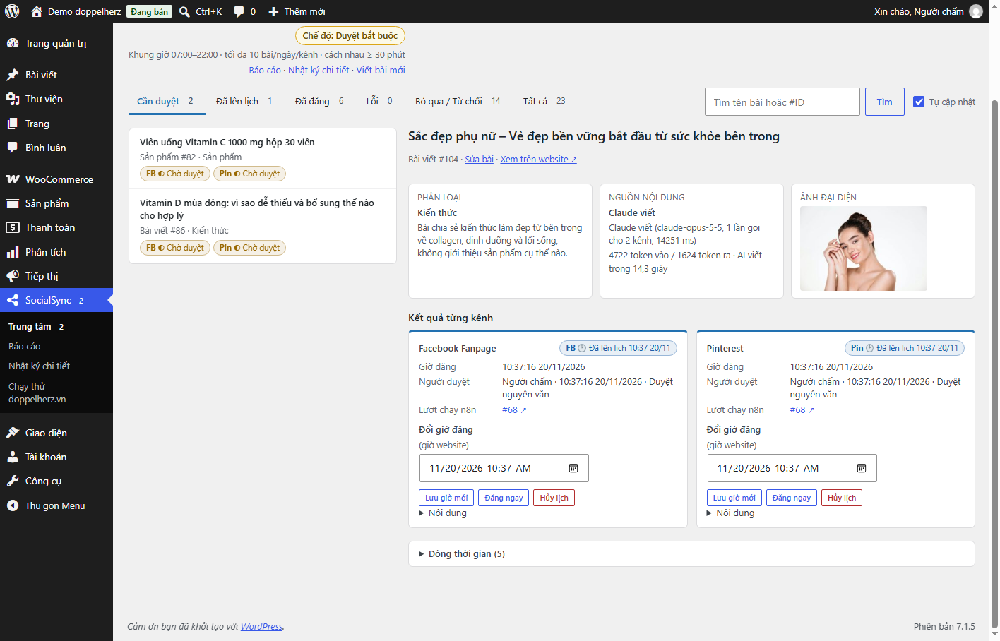

Vài giây sau, cả hai thẻ chuyển **● Đã đăng**, kèm nút **Mở bài trên Facebook Fanpage** / **Mở bài trên Pinterest**, người duyệt, giờ đăng và link lần chạy trên n8n.

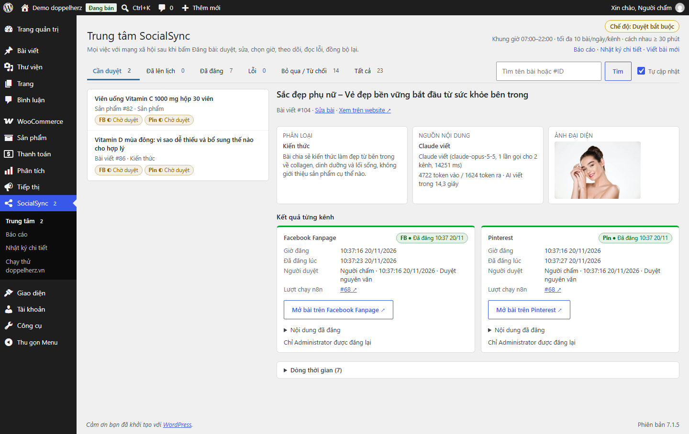

**Dòng thời gian** ở cuối ghi lại toàn bộ: xuất bản, tạo lượt, ai duyệt lúc nào (*Duyệt nguyên văn* hay *Người duyệt sửa: …*), giờ lên từng kênh. Đây là bằng chứng duyệt để đối chiếu khi kiểm tra pháp lý.

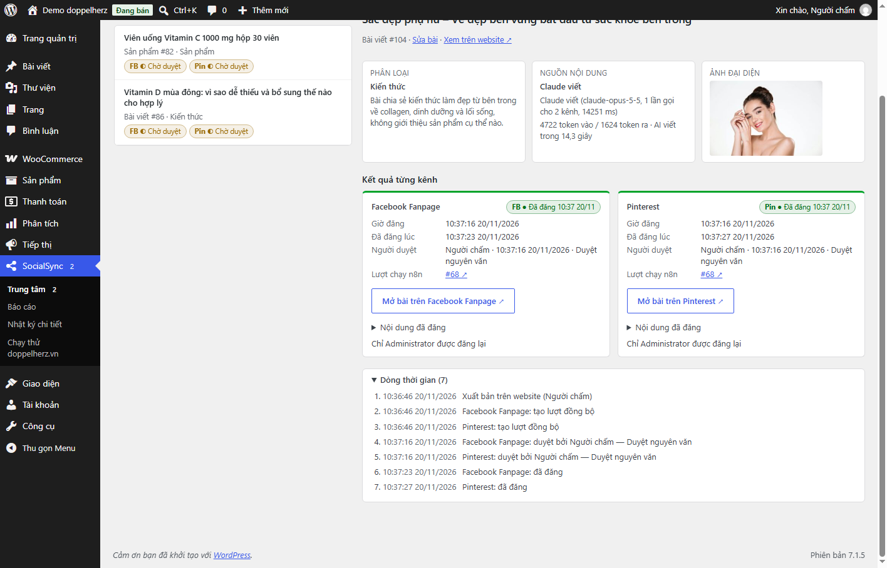

## Bước 9. Xem bài trên Facebook và Pinterest

Bài trên Fanpage *Mint Shop* (trang thử của ứng viên), xem khi **không đăng nhập**:

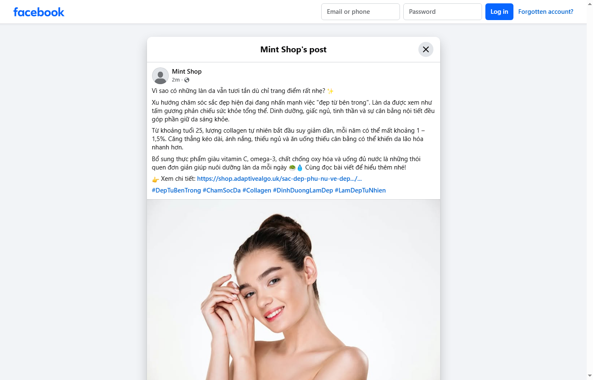

Pin trên Pinterest: tiêu đề và mô tả do Claude viết riêng cho Pinterest, link về bài gốc trên website:

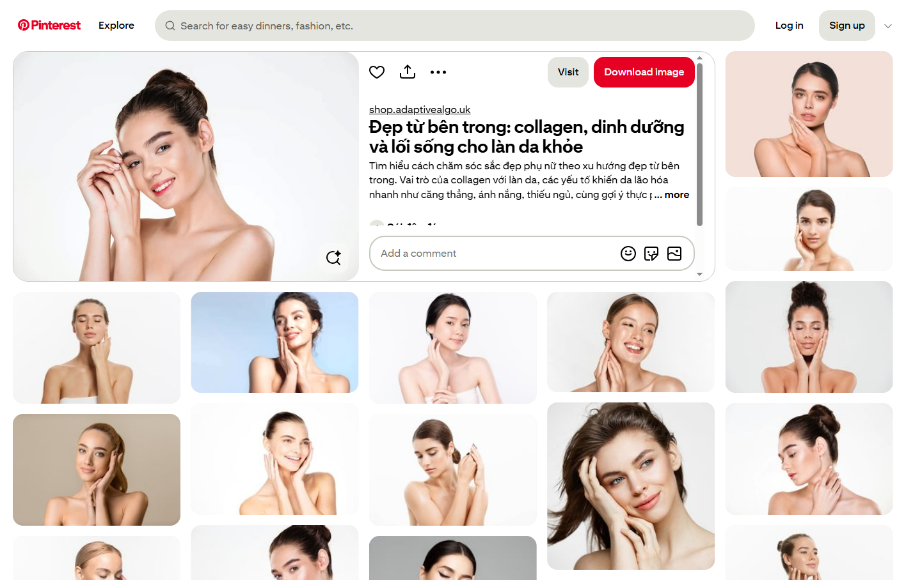

Pin nằm trong board **Làm đẹp** đúng theo danh mục của bài. Hai Pin ảnh spa bên cạnh là Pin thử khi dựng nhánh board trong Make.

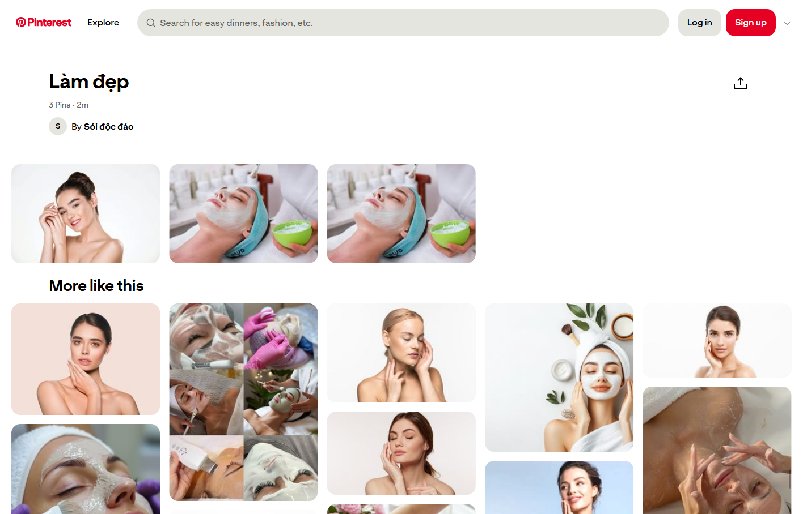

Ở ảnh 14–16 chúng tôi đã ẩn hộp mời đăng nhập của Facebook/Pinterest để ảnh rõ hơn. Nội dung phía sau là trang công khai, ai cũng xem được.

## Bước 10. Nhìn tổng thể từ danh sách bài

Ở **Bài viết → Tất cả bài viết** có cột **Mạng xã hội**: trạng thái từng kênh của mỗi bài. Bấm vào để mở đúng bài đó trong Trung tâm.

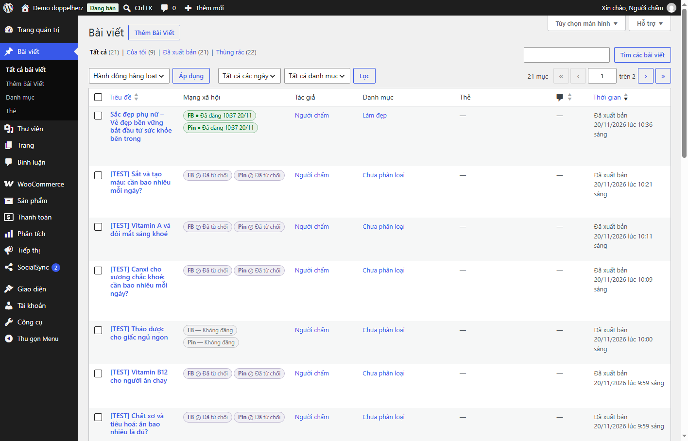

---

## Bên trong hệ thống đã chạy những gì

| Bước | Ai làm | Thời gian đo |
|---|---|---|
| Bắt sự kiện xuất bản, tạo 2 lượt, xếp giờ, gửi sang n8n | Plugin WordPress | ~0 giây (gửi nền) |
| Phân loại (Kiến thức) + viết nội dung riêng cho Facebook và Pinterest | Claude (claude-opus-5-5), 4.722 token vào / 1.624 token ra | 14,3 giây |
| Kiểm độ dài, từ cấm, gắn link UTM, chọn board theo danh mục | n8n | < 1 giây |
| Chờ người duyệt | Người chấm | 9 giây (lần chạy này) |
| Hỏi lại WordPress "còn đăng lượt này không?" (chống đăng khi đã hủy / đổi giờ) | n8n ↔ WordPress | < 1 giây mỗi kênh |
| Đăng ảnh + nội dung lên Fanpage | n8n → Facebook Graph API | 7 giây sau khi duyệt |
| Tạo Pin vào board Làm đẹp | n8n → Make.com → Pinterest | 11 giây sau khi duyệt |

## Khi có sự cố

| Thấy gì | Nghĩa là | Làm gì |
|---|---|---|
| Pinterest: *Không đăng: thiếu ảnh* | Bài không có ảnh đại diện | Thêm ảnh đại diện cho bài, rồi bấm **Đồng bộ lại** ở thẻ Pinterest trong Trung tâm |
| Thẻ kênh **Lỗi** | Kênh từ chối hoặc mất kết nối; lỗi đầy đủ hiện ngay trên thẻ | **Đăng lại nội dung đã duyệt** (giữ phần đã sửa, không gọi AI) hoặc **Cho AI viết lại** |
| Bảng trong trình soạn đứng ở *Đã gửi sang AI* quá 2 phút | n8n chưa nhận hoặc đang chậm | Mở Trung tâm: lượt kẹt có cảnh báo vàng và nút Đồng bộ lại |
| Bài ở *Bỏ qua / Từ chối* với lý do *Không đồng bộ* | Claude xếp bài là nội bộ/đại lý, hoặc bài thuộc danh mục bị chặn | Kiểm lý do trên thẻ; bài bị chặn ở WordPress phải gỡ khỏi danh mục chặn mới đồng bộ được |
